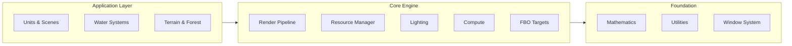

# Real-Time-Simulation-and-Visualization-of-Water-Surfaces

# Tough Water Rendering (TWR)

**Real-time water simulation and rendering engine**


---

## Important Notes

This repository is a **mirror** of a project originally developed in a private Perforce repository. As such:

- **Commit history** – All commits remain in the original Perforce repository. The author will attempt to export the full history at a later date.
- **Missing files** – External library binaries and the `bin/` folder containing shaders, textures, and models are **not included** in this repository. The project will not build or run without these files.
- **Experimental status** – This is a research/demonstration project, not a production-ready engine. It is provided for educational and reference purposes only.
- **No copying** – The code and assets are proprietary. Please refer to the license section below.

---

## Overview

Tough Water Rendering (TWR) is a high-performance graphics demonstration and research platform focused on real-time water simulation and rendering. Built on OpenGL 4.6 and the Win32 API, it provides an interactive environment for exploring:

- **Multiple water rendering techniques** – still water (reflection/refraction), projected grid, and SPH fluid simulation
- **Deferred rendering pipeline** – G‑buffer, multi‑pass lighting, shadow mapping
- **Compute shader acceleration** – matrix transformations and SPH fluid simulation
- **Modular architecture** – unit and scene system for rapid prototyping

A project presentation video delivered at the conference is available at the following link: https://www.youtube.com/watch?v=B5Pa8AALTZo

---

## Key Features

| Feature | Description |
|---------|-------------|
| **Water Simulation** | Three distinct water rendering approaches: still water with reflections/refractions, projected grid, and SPH particle fluid |
| **Deferred Rendering** | Full deferred pipeline with G‑buffer, multi‑pass lighting, and HDR support |
| **Dynamic Lighting** | Ambient, point, directional, and spot lights with shadow mapping |
| **GPU Compute** | Compute shaders for matrix transformations and fluid simulation |
| **Terrain Generation** | Procedural terrain with multi‑octave noise and vegetation instancing |
| **Modular Units** | Pluggable units for scenes, tests, and debugging |
| **Profiling Tools** | Built‑in profiler for performance analysis |

---

## System Requirements

- **OS**: Windows 10/11 (64‑bit)
- **GPU**: OpenGL 4.6 compatible with shader storage buffer support
- **RAM**: 8+ GB recommended
- **Build Tools**: Microsoft Visual Studio 2022 or newer

---

## Getting Started

> **Note:** The project **will not build** as-is due to missing external library binaries and asset files. The following instructions are for reference only.

### 1. Clone the repository
```bash
git clone https://github.com/yourusername/twr.git
cd twr
```

### 2. Open the solution
Open `twr.sln` in Visual Studio.

### 3. Set startup project
Set `TWR` as the startup project.

### 4. Build and run
Build the solution (Ctrl+Shift+B) and run (F5).

> **Missing dependencies:** The project requires external libraries (GLEW, libjpeg, libpng, DirectX) and the `bin/` folder with shaders, textures, and models. These are not included in this repository.

---

## Project Structure

```
twr/
├── bin/                    # Runtime assets (shaders, textures, models) – MISSING
├── src/
│   ├── anim/               # Animation system, units, scenes
│   ├── compute/            # Compute shader management
│   ├── light/              # Lighting system (lights, shadows)
│   ├── mrk/                # Markers (debug primitives)
│   ├── mth/                # Mathematics (vectors, matrices, camera, noise)
│   ├── pipeline/           # Render pipeline and targets
│   ├── res/                # Resource management
│   │   ├── buf/            # Shader storage buffers
│   │   ├── font/           # Font rendering
│   │   ├── img/            # Image loaders (BMP, PNG, TGA, JPG, DDS)
│   │   ├── models/         # G3DM model loader
│   │   ├── mtl/            # Materials and material patterns
│   │   ├── prims/          # Primitives and instancing
│   │   ├── shd/            # Shader compilation and reloading
│   │   ├── tex/            # Textures
│   │   └── topo/           # Topology helpers (grid, tangent space)
│   ├── system/             # System integration (logger, dir watcher, profiler)
│   ├── utils/              # Utilities (stock, logger, profiler, dir watcher)
│   ├── water/              # Water simulation (still water, fluid)
│   └── win/                # Window subsystem (Win32)
├── dependencies/           # External libraries – MISSING
└── twr.sln                 # Visual Studio solution
```

---

## Architecture Overview



### Key Modules

| Module | Responsibility |
|--------|----------------|
| **Window Subsystem** | Win32 window creation, message loop, full‑screen toggle |
| **Mathematics** | Vectors, matrices, camera, Perlin noise |
| **Resource Manager** | Textures, shaders, buffers, materials, models, fonts |
| **Targets** | Framebuffer objects for G‑buffer, lighting, merge |
| **Pipeline** | Deferred rendering: geometry → lighting → merge → final |
| **Lighting** | Light sources with shadow mapping |
| **Compute** | GPU matrix transformations and fluid simulation |
| **Markers** | Debug primitives (spheres, boxes, cylinders, tori) |
| **Units & Scenes** | Pluggable application modules and scene management |

---

## Water Rendering Techniques

### 1. Still Water (Reflection & Refraction)
- Flat grid with normal and du/dv maps
- Auxiliary cameras for reflection and refraction targets
- Fresnel blending with distortion

### 2. Projected Grid Water
- Dynamic grid aligned to camera frustum
- Wave displacement using 1D and 3D noise textures
- High detail near camera, lower detail in distance

### 3. SPH Fluid Simulation
- Particle‑based Smoothed Particle Hydrodynamics
- CPU and GPU (compute shader) implementations
- Viscosity, density, pressure, and collision handling

---

## Controls

| Key | Action |
|-----|--------|
| `Ctrl + Mouse` | Orbit camera |
| `W, A, S, D` | Move camera (free mode) |
| `V` | Toggle orbit/free camera mode |
| `Shift + C` | Switch to next scene |
| `Shift + P` | Pause simulation |
| `Shift + D` | Toggle debug mode |
| `Shift + W` | Toggle wireframe |
| `F11` | Toggle full‑screen |
| `Ctrl + F` | Reset camera |
| `Ctrl + Shift + Alt + P` | Toggle profiler |
| `Ctrl + Shift + Alt + C` | Toggle profiler collection |

---

## Scenes

The engine includes several predefined scenes that can be switched at runtime:

- **Still Water** – Reflection/refraction water surface
- **Projected Grid** – Dynamic projected water
- **Fluid** – SPH particle simulation
- **Terrain** – Procedural terrain with vegetation
- **Normal Mapping** – Normal mapping demo
- **Skybox** – Cubemap skybox demo

---

## Dependencies

- **GLEW** – OpenGL extension loading
- **libjpeg** – JPEG image loading
- **libpng** – PNG image loading
- **DirectX** – DDS texture loading (via DirectDraw)

> **Note:** Dependency binaries are **not included** in this repository.

---

## License

This project is proprietary software. No part of this software may be changed or redistributed without explicit written permission from the Computer Graphics Support Group of 30 Phys‑Math Lyceum.

This repository is provided for reference and educational purposes only. The code, assets, and design are the intellectual property of their respective authors.

---

## Authors

Developed by the Computer Graphics Support Group of 30 Phys‑Math Lyceum.

---

## Acknowledgements

Special thanks to the **Computer Graphics Support Group of 30 Phys‑Math Lyceum** for providing the foundation and inspiration for this project.

---

*Tough Water Rendering – CGSG'2024*