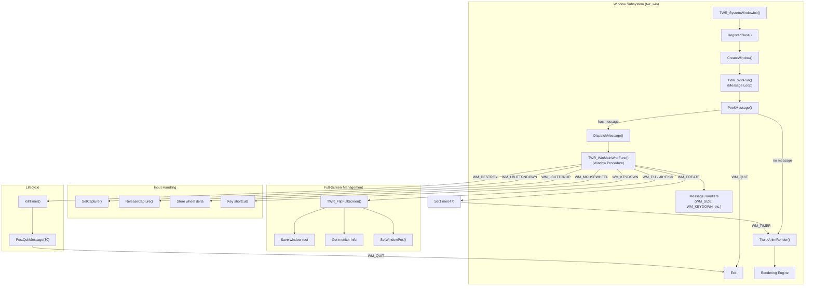
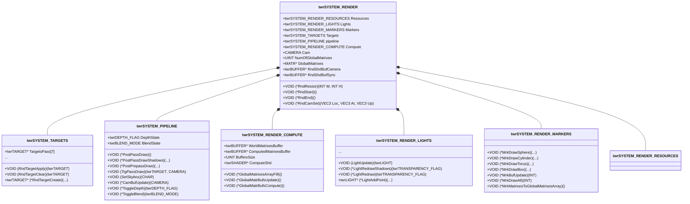
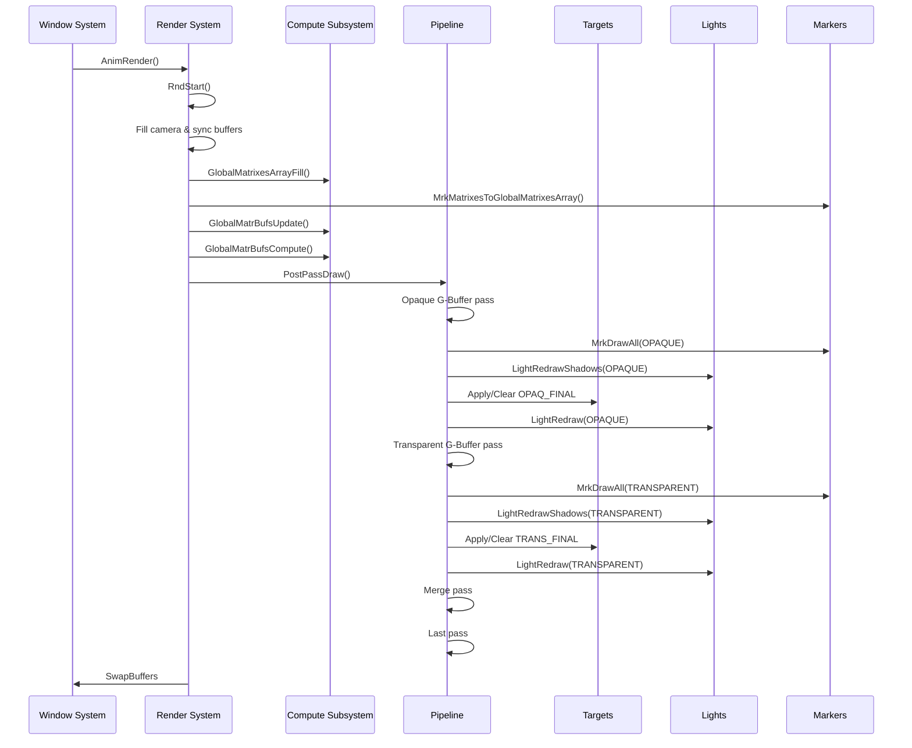
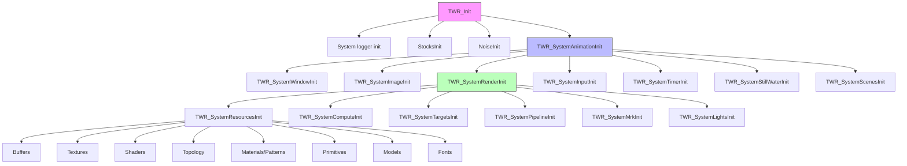
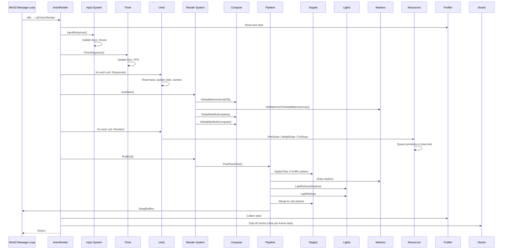
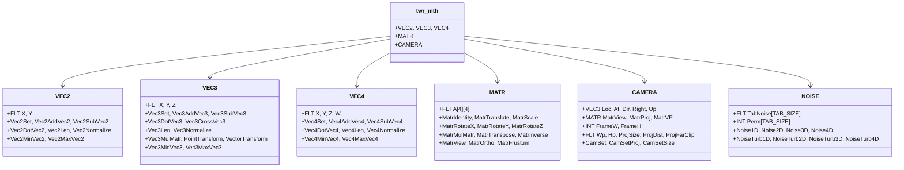
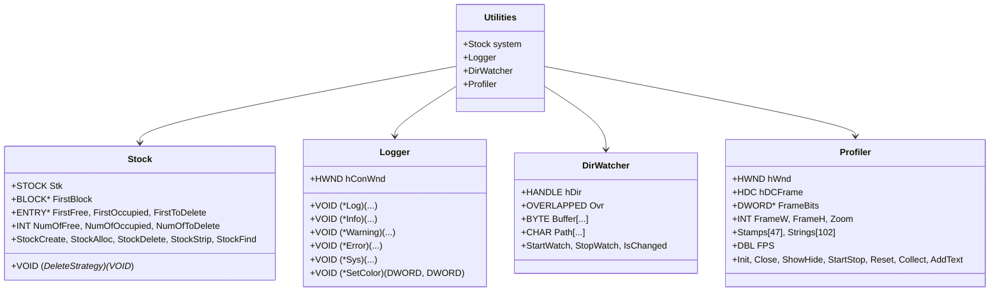
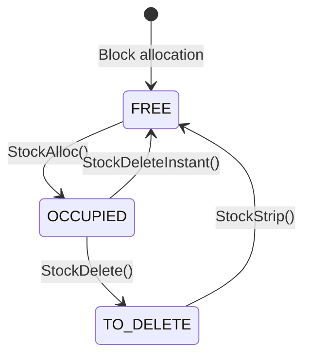
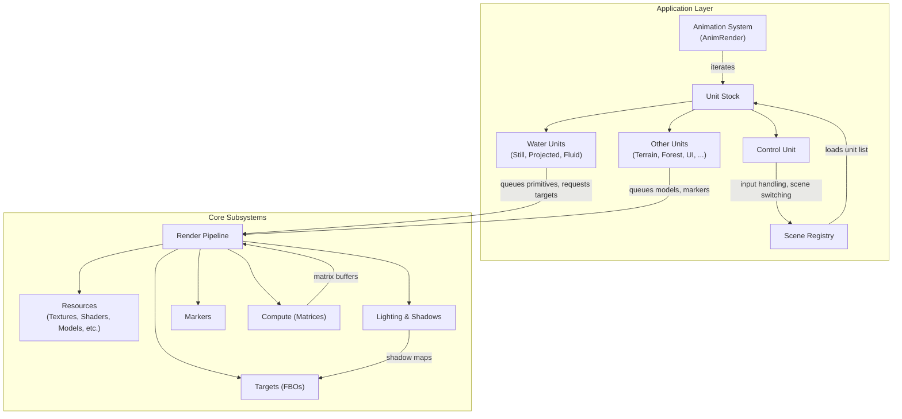

## Tough Water Rendering Project — Specification

### Overview

The Tough Water Rendering (TWR) project is a graphics demonstration and research application focused on real‑time water simulation and rendering. Built on the Win32 API and Vulkan, it provides a high‑performance interactive environment for exploring water surface dynamics, refraction, reflection, and caustics. The project shares architectural patterns with the TAM project but is tailored specifically for water rendering, with a simplified structure and a strong emphasis on visual quality and performance.

This specification covers the coding standards, documentation conventions, and the window subsystem that forms the foundation of the application. The window system manages the main application window, handles user input, controls the message loop, and coordinates the rendering cycle.

---

## 1. Coding Standards

### 1.1 General Principles

The TWR project follows a consistent coding style to ensure maintainability, readability, and ease of collaboration. All source files must adhere to the conventions described below.

- **Language:** C (with some C++ features in header files, but primarily C).
- **Indentation:** Two spaces per indent level. Opening and closing braces for functions, conditionals, and loops are placed on separate lines.
- **Line Length:** Prefer lines under 120 characters; wrap long lines for readability.
- **Comments:** Use `/* ... */` for block comments. Avoid `//` style comments in C sources (though they may appear in C++ code). All major functions, structures, and files must have descriptive comments.

### 1.2 File Header Documentation

Every source file must begin with a standard header containing copyright information, file description, author, last update, and notes.

**Required format:**
```c
/***************************************************************
 * Copyright (C) 2025
 *    Computer Graphics Support Group of 30 Phys-Math Lyceum
 ***************************************************************/

/* FILE NAME   : twr_win.c
 * PURPOSE     : Tough Water Rendering project.
 *               Window depended WinAPI handle implementation module.
 * PROGRAMMER  : CGSG'2024.
 *               Vitaly A. Galinsky (VG4).
 * LAST UPDATE : 18.04.2025
 * NOTE        : Module prefix 'twr'.
 *
 * No part of this file may be changed without agreement of
 * Computer Graphics Support Group of 30 Phys-Math Lyceum
 */
```

Every file must end with:
```c
/* END OF 'twr_win.c' FILE */
```
The closing marker must contain the exact file name.

### 1.3 Naming Conventions

#### 1.3.1 General Naming

- **Types** (structures, enums, typedefs): Use **PascalCase** or **ALL_CAPS** with a `twr` prefix for global types. Example: `twrSYSTEM_WINDOW`.
- **Functions**: Use **PascalCase** with a `TWR_` prefix for module‑exported functions. Example: `TWR_SystemWindowInit`, `TWR_FlipFullScreen`.
- **Static functions**: Use **PascalCase** without a module prefix, or with a descriptive prefix. Example: `TWR_WinMainWndFunc`.
- **Variables**: Use **camelCase** or **PascalCase**; global variables typically start with a capital letter. Example: `Twr` (global application state pointer).
- **Constants and macros**: Use **ALL_CAPS** with underscores. Example: `TWR_WINDOW_CLASS_NAME`.

#### 1.3.2 File Naming

Source files use lowercase letters with underscores. Example: `twr_win.c`, `twr_win.h`.

### 1.4 Commenting

- **Structures and types** must have a descriptive comment explaining their purpose.
- **Functions** must have a comment block describing the function’s purpose, arguments (if any), and return value.
- **In‑line comments** should explain non‑obvious logic.

**Example:**
```c
/* Window subsystem initialization function.
 * ARGUMENTS: None.
 * RETURNS: None.
 */
VOID TWR_SystemWindowInit( VOID )
{
  ...
}
```

### 1.5 Indentation and Bracket Style

- Two spaces per indent.
- Opening brace on a new line for functions and control structures.
- For single‑statement blocks, braces may be omitted for clarity if the statement is on the same line, but consistency is preferred.

```c
if (Condition)
{
  Execute();
}
```

### 1.6 Code Organisation

Source files should follow this order:

1. File header (copyright and description).
2. `#include` directives.
3. Local constants and macros.
4. Static function declarations (if needed).
5. Exported function implementations.
6. Static function implementations.
7. File closing marker.

---

## 2. Window Subsystem

### 2.1 Purpose

The window subsystem provides the primary interface between the application and the Microsoft Windows operating system. Its responsibilities include:

- Registering the application window class.
- Creating and managing the main application window.
- Handling the Windows message loop.
- Dispatching system events to the engine (input, resize, timer, etc.).
- Managing full‑screen mode.
- Providing a unified abstraction layer over the Win32 API.

The subsystem is implemented in `twr_win.c` and `twr_win.h` and is kept separate from rendering and simulation logic to maintain clear separation of concerns.

### 2.2 Window Class Registration

Before a window can be created, a window class must be registered. The class defines how all windows of this type behave.

**Registration process:**

1. The application instance handle (`hInstance`) is obtained via `GetModuleHandle(NULL)`.
2. The `WNDCLASS` structure is filled with:
   - `style` – `CS_HREDRAW | CS_VREDRAW` to force redraw on horizontal/vertical resizing.
   - `lpfnWndProc` – pointer to the main window procedure `TWR_WinMainWndFunc`.
   - `hbrBackground` – default background brush (though rendering overrides this).
   - `hCursor` – `IDC_HAND` for a hand cursor.
   - `hIcon` – a custom logo resource (`IDI_LOGO`).
   - `lpszClassName` – a unique class name string.
3. `RegisterClass` is called; failure is reported and the application exits.

**Why Win32 API:**
- Native access to Windows messaging and full‑screen control.
- Direct integration with Vulkan surface creation (via `HWND`).
- No external dependencies (such as GLFW or SDL).
- Full control over window creation and event handling.

### 2.3 Window Creation

After registration, the main window is created using `CreateWindow`:

```c
Twr->hWnd = CreateWindow(TWR_WINDOW_CLASS_NAME,
                         TWR_WINDOW_TITLE,
                         WS_OVERLAPPEDWINDOW | WS_VISIBLE,
                         0, 0, 2000, 1200,
                         NULL, NULL, Twr->hInstance, NULL);
```

**Parameters:**
- **Class name:** `TWR_WINDOW_CLASS_NAME`.
- **Window title:** `"CGSG'Jr'2024::Tough Water Rendering system"`.
- **Style:** `WS_OVERLAPPEDWINDOW` (title bar, system menu, min/max/close buttons, resizable borders) combined with `WS_VISIBLE` to make the window immediately visible.
- **Initial position and size:** The window is placed at (0,0) with size 2000×1200 (a reasonable default for a graphics demo).
- **Instance handle:** The application instance.

The `CW_USEDEFAULT` values are not used here; explicit coordinates and sizes are provided to guarantee a consistent initial appearance.

### 2.4 Window Procedure

The central message dispatcher is `TWR_WinMainWndFunc`. It handles a wide range of Windows messages:

| Message | Handler Action |
|---------|----------------|
| `WM_GETMINMAXINFO` | Sets minimum and maximum window size constraints (avoids tiny windows, sets maximum track size). |
| `WM_CREATE` | Sets a timer (ID 47) for periodic rendering. |
| `WM_SIZE` | Updates the window dimensions (`W`, `H`), triggers renderer resize and redraw if the system is initialised. |
| `WM_TIMER` | Calls `Twr->AnimRender()` if the system is ready. |
| `WM_ERASEBKGND` | Prevents background erasure and forces a render call (avoids flicker). |
| `WM_KEYDOWN` | Handles keyboard shortcuts: <kbd>Esc</kbd> prompts exit, <kbd>F11</kbd> toggles full‑screen, <kbd>Ctrl+Shift+Alt+P</kbd> toggles the profiler, <kbd>Ctrl+Shift+Alt+Q</kbd> toggles the console window. |
| `WM_SYSKEYDOWN` | Detects <kbd>Alt+Enter</kbd> to toggle full‑screen. |
| `WM_LBUTTONDOWN/UP` | Captures/releases the mouse for drag operations. |
| `WM_MOUSEWHEEL` | Stores the wheel delta in `Twr->MouseWheel`. |
| `WM_ENTERSIZEMOVE` / `WM_EXITSIZEMOVE` | Pauses/resumes rendering during window resizing/moving to avoid glitches. |
| `WM_ACTIVATE` | Tracks window activity state (`IsActive`). |
| `WM_PAINT` | Calls `AnimRender()` and validates the paint region. |
| `WM_DESTROY` | Kills the timer, posts `WM_QUIT`, and resets window state. |

All unhandled messages are passed to `DefWindowProc`.

### 2.5 Main Message Loop

The application’s execution is driven by `TWR_WinRun`, which implements a classic message pump:

```c
while (TRUE)
  if (PeekMessage(&msg, NULL, 0, 0, PM_REMOVE))
  {
    if (msg.message == WM_QUIT)
      break;
    DispatchMessage(&msg);
  }
  else
    if (Twr->IsInit)
      Twr->AnimRender();
```

**Key design decisions:**
- **PeekMessage over GetMessage:** The loop does not block when no messages are waiting. Instead, it immediately proceeds to render a frame, ensuring high frame rates and responsiveness.
- **Idle rendering:** When the message queue is empty, `AnimRender()` is called to keep the animation running.
- **Timer‑based rendering:** A Windows timer (ID 47) is set during `WM_CREATE`. The `WM_TIMER` handler also calls `AnimRender()`, ensuring that rendering occurs even if the message queue is busy, and providing a fallback for systems where `PeekMessage` alone might starve the renderer.

### 2.6 Full‑Screen Mode

Full‑screen toggling is implemented in `TWR_FlipFullScreen`:

1. **Entering full‑screen:**
   - The current window rectangle is saved.
   - The monitor info is obtained via `MonitorFromWindow` and `GetMonitorInfo`.
   - The window is resized to cover the entire monitor using `SetWindowPos` with `HWND_TOP`.

2. **Exiting full‑screen:**
   - The window is restored to its saved rectangle using `SetWindowPos` with `HWND_NOTOPMOST`.

The function is accessible through the `Twr->FlipFullScreen` function pointer, allowing the rendering engine to call it. Full‑screen can be triggered by <kbd>F11</kbd> or <kbd>Alt+Enter</kbd>.

### 2.7 Input Handling

- **Keyboard:** `WM_KEYDOWN` captures key presses. Special combinations (e.g., <kbd>Ctrl+Shift+Alt+P</kbd>) toggle debug features.
- **Mouse:** `WM_LBUTTONDOWN` captures the mouse (`SetCapture`), allowing drag operations even when the cursor leaves the window. `WM_LBUTTONUP` releases the capture. The mouse wheel delta is stored in `Twr->MouseWheel`.
- **Window Activation:** The `IsActive` flag is updated on `WM_ACTIVATE` and `WM_ENTERSIZEMOVE`/`WM_EXITSIZEMOVE` to suspend rendering when the window is not visible or is being resized.

### 2.8 Timer and Rendering Cycle

The timer (ID 47) is set with a period of 0 milliseconds, which requests Windows to send `WM_TIMER` messages as soon as possible. This, combined with the idle‑loop rendering, ensures that the render function is called continuously. The rendering function `Twr->AnimRender()` is assumed to be provided by the rendering module and is responsible for updating simulation and presenting the frame.

### 2.9 Integration with the Application State

All window‑related state is stored in a global structure `twrSYSTEM_WINDOW`, typically referenced by the global pointer `Twr`. This structure holds:

- `hInstance`, `hWnd` – instance and window handles.
- `W`, `H` – current window dimensions.
- `IsActive` – whether the window is active.
- `IsFullScreen` – full‑screen status.
- `MouseWheel` – accumulated wheel delta.
- Function pointers `FlipFullScreen` and `Run` – allowing the rendering engine to invoke window operations.

This design separates the window subsystem from the rest of the application, enabling clean initialisation and shutdown.

### 2.10 Initialisation and Shutdown

- **Initialisation:** `TWR_SystemWindowInit` registers the window class, creates the window, and sets up the global state.
- **Shutdown:** `TWR_SystemWindowClose` is a stub (but in practice would clean up resources). The window is destroyed when `WM_DESTROY` posts `WM_QUIT`.

### 2.11 Architecture Diagram



---

Certainly. Here is the complete English-language specification for the Graphics Subsystem of the **Tough Water Rendering (TWR)** project.

---

# Graphics Subsystem Specification – TWR Project

## 1. Introduction

### 1.1 Purpose

The Graphics Subsystem (Render System) is the core of visualisation in TWR. It is responsible for:

- Initialising and managing the OpenGL rendering context.
- Configuring framebuffer objects (FBOs) for multi‑pass rendering.
- Orchestrating the rendering pipeline (geometry, lighting, post‑processing).
- Managing light sources (ambient, point, directional, spot) and shadows.
- Performing GPU‑accelerated matrix transformations via compute shaders.
- Providing debugging visualisation (markers).
- Offering abstractions over GPU resources (textures, buffers, shaders, materials, primitives).

The subsystem is designed for flexibility, performance, and ease of extension. It integrates tightly with the Win32 window system, which supplies the device context (HDC) and the window for display.

### 1.2 Core Requirements

- **Performance:** Real‑time rendering with high frame rates.
- **Image Quality:** Support for HDR, reflections, refractions, shadows, and water effects.
- **Modularity:** Each functional area (targets, lighting, compute, markers) is isolated in its own module.
- **Scalability:** New render passes and light types can be added without disrupting existing code.
- **Debugging:** Built‑in marker system and OpenGL debug output.

### 1.3 Relationship with the Window Subsystem

The window subsystem provides:

- The window handle (`HWND`) and device context (`HDC`).
- The message loop, which triggers rendering via `Twr->AnimRender()`.
- Resize handling (`WM_SIZE`), which calls `Twr->RndResize` to update target sizes.

Rendering runs in the same thread as the window loop, with `SwapBuffers` presenting the final image.

---

## 2. Overall Architecture

The Graphics Subsystem is embodied by the `twrSYSTEM_RENDER` structure, which aggregates all sub‑systems and render data. It is accessible via the global pointer `Twr`.



The subsystems cooperate as follows:

- **Resources** manage textures, buffers, shaders, materials, and primitives (present but not detailed in the provided files; referenced via `twrSYSTEM_RENDER_RESOURCES`).
- **Targets** define the set of FBOs used for each render pass.
- **Pipeline** controls the sequence of rendering, depth/stencil and blend states.
- **Compute** prepares world matrices on the GPU.
- **Lighting** manages light sources, shadows, and their application.
- **Markers** provides debug visualisation.

---

## 3. Initialisation and Shutdown

### 3.1 Graphics System Initialisation

`TWR_SystemRenderInit` performs the following steps:

1. **Obtain the device context** (`HDC`) via `GetDC(Twr->hWnd)`.
2. **Set up pixel format** using `PIXELFORMATDESCRIPTOR`:
   - Double buffering (`PFD_DOUBLEBUFFER`).
   - OpenGL support (`PFD_SUPPORT_OPENGL`).
   - 32 bits per colour, 32 bits for depth.
3. **Create a temporary context** to initialise GLEW and fetch extensions.
4. **Initialise GLEW** to load OpenGL function pointers.
5. **Select an advanced pixel format** via `wglChoosePixelFormatARB` to support modern features.
6. **Create the main OpenGL context** (version 4.6 Core Profile) using `wglCreateContextAttribsARB`.
7. **Set global OpenGL states**:
   - Enable blending (`GL_BLEND`) with `GL_ONE, GL_ZERO`.
   - Enable depth test (`GL_DEPTH_TEST`).
   - Enable primitive restart (`GL_PRIMITIVE_RESTART`) with index `-1`.
   - Disable vertical sync (`wglSwapIntervalEXT(0)`).
8. **Configure OpenGL debug output** (if `NDEBUG` is not defined):
   - Enable `GL_DEBUG_OUTPUT` and `GL_DEBUG_OUTPUT_SYNCHRONOUS`.
   - Set the callback `TWR_glDebugOutput`.
9. **Initialise subsystems** in dependency order:
   - `TWR_SystemResourcesInit` – resources.
   - `TWR_SystemComputeInit` – compute subsystem (creates matrix buffers and compute shader).
   - `TWR_SystemTargetsInit` – creates target FBOs.
   - `TWR_SystemPipelineInit` – configures the pipeline (full‑screen primitives for merging, skybox).
   - `TWR_SystemMrkInit` – markers.
   - `TWR_SystemLightsInit` – lighting (creates materials and primitives for light sources).
10. **Create and apply UBOs** for camera and synchronisation (`RndShdBufCamera`, `RndShdBufSync`).
11. **Set initial camera** via `CamSet` and `CamSetProj`.

### 3.2 Shutdown

`TWR_SystemRenderClose` frees resources in reverse order, deletes the OpenGL context, and releases the HDC.

---

## 4. Camera Management

### 4.1 CAMERA Structure

The camera is stored in a structure containing:

- `Loc`, `At`, `Up` – position, look‑at point, and up vector.
- `Right`, `Dir` – computed right and forward vectors.
- `MatrView`, `MatrProj`, `MatrVP` – view, projection, and combined matrices.
- `ProjSize`, `ProjDist` – projection parameters (size and distance for orthographic or perspective).
- `FrameW`, `FrameH` – viewport dimensions.

### 4.2 Camera Control Functions

- `Twr->RndCamSet(Loc, At, Up)` – sets the camera from three points and updates matrices.
- `CamSetProj(&cam, ProjSize, ProjDist, far)` – configures the projection matrix (perspective or orthographic depending on mode).
- `CamSetSize(&cam, W, H)` – updates aspect ratio and frame size.

### 4.3 Camera UBO

Camera data is uploaded to the UBO `RndShdBufCamera` of type `twrRND_UBO_CAMERA`:

```c
typedef struct tagtwrRND_UBO_CAMERA {
    MATR MatrVP;
    MATR MatrV;
    MATR MatrP;
    VEC4 CamLoc;
    VEC4 CamRight;
    VEC4 CamUp;
    VEC4 CamDir;
    VEC4 CamAt;
    VEC4 FrameWHProjSizeDist;
} twrRND_UBO_CAMERA;
```

This buffer is updated whenever the camera changes (via `TWR_CamBufUpdate`) and is consumed by all shaders.

---

## 5. Resource Subsystem

The resource subsystem (not detailed in the provided files but present via `twrSYSTEM_RENDER_RESOURCES`) manages:

- **Textures** – creation, loading, binding, resizing.
- **Buffers** (VBO, UBO, SSBO) – creation, data update, binding to binding points.
- **Shaders** – compilation, linking, application.
- **Materials** (`twrMATERIAL`) – combine shader, textures, and parameters; can be opaque or transparent.
- **Material patterns** (`twrMATERIAL_PATTERN`) – describe the material’s attribute layout and texture count.
- **Primitives** (`twrPRIM`) – contain vertex/index data, instance count, and world transformation matrices.

Resources use reference counting (`ReferenceInc/Free`) for memory management and are stored in `STOCK` structures (dynamic arrays with deletion support).

---

## 6. Target Buffers (Framebuffers)

### 6.1 Purpose

Target buffers (`twrTARGET`) are FBOs with colour and depth attachments. They are used for multi‑pass rendering: G‑buffer for geometry, final lighting buffers, a merge buffer, and a final output buffer.

### 6.2 Pass Types

The `twrTRG_PASS_TYPE` enum defines target indices:

| Index | Name | Description |
|-------|------|-------------|
| `TWR_OPAQ_PASS` | Opaque G‑Buffer | Stores albedo, normals, positions, roughness, etc. for opaque objects. |
| `TWR_OPAQ_FINAL_PASS` | Opaque Final | Result of lighting for opaque objects. |
| `TWR_TRANS_PASS` | Transparent G‑Buffer | G‑Buffer for transparent objects. |
| `TWR_TRANS_FINAL_PASS` | Transparent Final | Result of lighting for transparent objects. |
| `TWR_SHADOW_PASS` | Shadow | Buffer for shadow maps (depth only). |
| `TWR_MERGE_PASS` | Merge | Buffer for compositing opaque and transparent finals. |
| `TWR_LAST_PASS` | Last | Final buffer that is displayed (contains colour and depth from merge). |

### 6.3 twrTARGET Structure

```c
struct twrtagTARGET {
    CHAR Name[TWR_STR_MAX];
    UINT FBOId;
    INT W, H;
    twrTEXTURE *Attachments[8];
    INT NumOfAttachments;
    twrTEXTURE *Depth;
    BOOL IsDepthShare;
};
```

- `Attachments` – colour attachments (RGBA32F for G‑buffer, RGBA8 for finals).
- `Depth` – depth attachment (usually `GL_DEPTH_COMPONENT24`).
- `IsDepthShare` – indicates that the depth is shared with another target (e.g., `MERGE` and `LAST` share the same depth).

### 6.4 Target Management Functions

- **Create**: `TWR_RndTargetCreate` creates an FBO, attaches colour and optionally depth textures.
- **Apply**: `TWR_RndTargetApply` binds the FBO and sets the viewport.
- **Clear**: `TWR_RndTargetClear` clears colour attachments and (if not shared) depth.
- **Resize**: `TWR_RndTargetResize` resizes all attachments and updates the FBO.
- **Free**: `TWR_RndTargetFree` deletes the FBO and releases textures.

---

## 7. Compute Subsystem

### 7.1 Purpose

The compute subsystem transforms world matrices of objects into view‑projection and inverse matrices using a compute shader. This offloads the CPU and centralises matrix calculations for all primitive instances.

### 7.2 Data Flow

1. **Gather matrices**: `TWR_GlobalMatrixesArrayFill` iterates over all materials and primitives, copying their world matrices into `Twr->GlobalMatrixes`.
   - For each primitive, `FirstMatrixIndex` is stored (offset in the global array).
   - The array is dynamically expanded in chunks of `TWR_FORWARD_ALLOCATION_MATRS` (300).
2. **Update input buffer**: `TWR_GlobalMatrBufsUpdate` copies the matrix array into the SSBO `WorldMatrixesBuffer`.
   - The buffer is resized if `NumOfGlobalMatrixes` exceeds the current `BuffersSize`.
3. **Dispatch compute shader**: `TWR_GlobalMatrBufsCompute` applies the compute shader `ComputeShd` (named "matrix") and dispatches groups of 1024 threads.
   - The output buffer `ComputedMatrixesBuffer` contains, for each world matrix, a pair: `MatrWVP` and `MatrWInv` (or equivalent).
4. **Memory barrier** – `glMemoryBarrier(GL_SHADER_STORAGE_BARRIER_BIT)` ensures data visibility for subsequent draws.

### 7.3 Buffers and Shaders

- `WorldMatrixesBuffer` – input SSBO with world matrices (binding `TWR_BUF_BIND_MATRIX_IN`).
- `ComputedMatrixesBuffer` – output SSBO with computed matrices (binding `TWR_BUF_BIND_MATRIX_OUT`).
- `ComputeShd` – compute shader compiled from the file "matrix".

---

## 8. Rendering Pipeline

### 8.1 Overview

The pipeline is implemented in `twr_rnd_pipeline.c`. The main entry point is `TWR_RndPostPassDraw`, which is called at the end of each frame. It executes the following sequence:

1. **Matrix preparation**:
   - `Twr->GlobalMatrixesArrayFill()` – collect world matrices.
   - `Twr->MrkMatrixesToGlobalMatrixesArray()` – add marker matrices.
   - `Twr->GlobalMatrBufsUpdate()` – update SSBOs.
   - `Twr->GlobalMatrBufsCompute()` – compute WVP/WInv on GPU.
2. **Render passes**:
   - **Opaque G‑Buffer** – draw opaque objects into the G‑buffer.
   - **Lighting (Opaque)** – apply lighting to the opaque G‑buffer, output to `OPAQ_FINAL_PASS`.
   - **Transparent G‑Buffer** – draw transparent objects into the G‑buffer (no sorting required because lighting is deferred).
   - **Lighting (Transparent)** – apply lighting to transparent objects, output to `TRANS_FINAL_PASS`.
   - **Merge** – composite opaque and transparent finals into `MERGE_PASS` using a full‑screen quad.
   - **Last** – display `MERGE_PASS` on screen (or into a final buffer) with tone mapping/gamma correction via another full‑screen quad.
3. **State management**: depth and blend states are toggled via `TWR_RndToggleDepth` and `TWR_RndToggleBlend`.

### 8.2 Pipeline Functions

#### `TWR_RndPostPrepassDraw`

Draws all primitives of a given type (opaque or transparent) into a specified target.

- **Arguments**: target buffer, camera, pass flag (`TWR_MTL_OPAQUE`, `TWR_MTL_TRANSPARENT`, `TWR_MTL_SHADOW`, `TWR_MTL_FINAL`), clear flag.
- **Algorithm**:
  1. Update camera UBO.
  2. Apply and (optionally) clear the target.
  3. If pass is `TWR_OPAQ_PASS`, draw the skybox.
  4. Draw markers (unless pass is shadow or final).
  5. Iterate over all material patterns (`Twr->FirstDraw`):
     - Apply pattern shader.
     - For each material:
       - Apply material.
       - For each primitive:
         - If the primitive’s transparency matches the pass (or pass is shadow), call `Twr->PrimDrawInstant(Pr)`.
  6. Restore the original camera.

#### `TWR_RndDoMerge`

Merges opaque and transparent finals into a target using the full‑screen primitive `TWR_TrgMergeFullscreenPrim`.

- Input textures:
  - `TWR_OPAQ_FINAL_PASS` – colour.
  - `TWR_OPAQ_PASS` – depth (used for correct blending).
  - `TWR_TRANS_FINAL_PASS` – colour.
  - `TWR_TRANS_PASS` – depth.
- Blend mode is set to `TWR_BLEND_REPLACE`, but the shader itself performs the composition based on depth and alpha.
- If `IsFinalDraw` is true, additional final primitives (e.g., post‑processing) are drawn.

#### `TWR_RndDoLast`

Outputs the content of `MERGE_PASS` to the screen using `TWR_TrgLastFullscreenPrim`. This primitive may apply tone mapping, gamma correction, or other post‑effects. Its inputs include the colour and depth from `MERGE_PASS`, as well as all G‑buffer attachments (for potential debug overlays, though not mandatory).

### 8.3 Depth and Blend State Management

- `TWR_RndToggleDepth` enables/disables depth test and depth writes according to the given `twrDEPTH_FLAG`.
- `TWR_RndToggleBlend` sets the blending function (alpha, additive, replace) based on `twrBLEND_MODE`.

States are stored in `Twr->DepthState` and `Twr->BlendState` to avoid redundant OpenGL calls.

### 8.4 Skybox

- Set via `TWR_SetSkybox`, which creates a material and a primitive with a cubemap texture.
- Rendered in the `TWR_OPAQ_PASS` with depth disabled (`TWR_DEPTH_NOT_READ_NOT_WRTIE`) so it always appears behind the scene.

---

## 9. Lighting

### 9.1 Light Types

Four types are supported (`twrLIGHT_TYPE`):

- `TWR_LIGHT_AMBIENT` – ambient light (no position, uniform illumination).
- `TWR_LIGHT_POINT` – point light with position, colour, attenuation, and cut‑off distance.
- `TWR_LIGHT_DIR` – directional (infinite) light with direction and colour.
- `TWR_LIGHT_SPOT` – spot light with position, direction, inner/outer cone angles, attenuation, and cut‑off distance.

### 9.2 twrLIGHT Structure

```c
struct tagtwrLIGHT {
    twrLIGHT_TYPE Type;
    VEC3 Pos, Dir, Color, Att;
    VEC2 CutOffAngle, CutOffAngleCos;
    VEC2 CutOffDist;
    BOOL IsShadowCast, IsEnabled;
    MATR ShadowMatr;
    twrTARGET *ShadowTarget;
    INT ShadowSize;
    twrBUFFER *Buffer;
    twrPRIM *Prim[2];
};
```

- `Buffer` – UBO containing light data (`twrRND_BUF_LIGHT`).
- `Prim[2]` – full‑screen primitives for opaque and transparent passes (used when applying lighting).
- `ShadowTarget` – FBO for shadow maps (depth only).

### 9.3 Light Data Update

`TWR_LightUpdate` fills the `twrRND_BUF_LIGHT` structure and updates the UBO:

- Position and cut‑off angle cosines.
- Direction.
- Colour.
- Attenuation and cut‑off distances.
- Flags and light type.
- Shadow matrix (`ShadowMatr`).

### 9.4 Shadows

- **Enabling shadows**: `TWR_LightEnableShadow` creates a target buffer for the shadow map (size `TWR_SHADOW_MAP_SIZE = 4096`). Supported for directional and spot lights.
- **Shadow rendering**: `TWR_LightRedrawShadows` for each enabled light:
  1. Computes the view‑projection matrix from the light’s perspective (orthographic for directional, perspective for spot).
  2. Sets the light camera.
  3. Calls `Twr->PostPassDrawShadows`, which draws the scene with `glPolygonOffset` enabled (to avoid shadow acne) into `ShadowTarget`.
  4. The shadow matrix is stored in the light and passed to the lighting shader.
- **Using shadows**: during lighting rendering, the depth texture from `ShadowTarget` is bound to texture unit 6 (or another) and used by the shader.

### 9.5 Lighting Rendering

`TWR_LightRedraw` is called separately for opaque and transparent passes.

- Additive blending (`TWR_BLEND_ADD`) is enabled, and depth test is disabled (to allow correct light accumulation).
- For each enabled light:
  - The light’s shader is applied.
  - The light’s UBO is bound.
  - If shadow casting is enabled, the shadow texture is bound.
  - The full‑screen primitive `Prim[PassFlag]` is drawn, which reads the G‑buffer, computes lighting, and adds it to the final buffer.

After the pass, blend and depth states are restored.

---

## 10. Markers (Debug Visualisation)

### 10.1 Purpose

Markers allow rendering auxiliary geometric primitives (sphere, cylinder, torus, box) for debugging, e.g., light positions, bounding volumes, or trajectories.

### 10.2 Storage

Markers are stored in a 2D array `TWR_Markers[opaqueTrans][type]`, where:

- `opaqueTrans` – 0 for opaque, 1 for transparent.
- `type` – primitive type (sphere, cylinder, torus, box).

For each type, the system maintains:
- An array of `twrMARKER` records (colour, parameters, transformation matrix).
- `TWR_MrkSize`, `TWR_MrkMaxSize` – current and maximum counts.
- `TWR_MrkBuffers` – SSBO for transferring marker data to shaders.
- `TWR_MrkMaterial` and `TWR_MrkPrims` – materials and primitives for rendering.

### 10.3 Adding Markers

Functions `TWR_MrkDrawSphere`, `TWR_MrkDrawCylinder`, `TWR_MrkDrawTorus`, `TWR_MrkDrawBox` are called externally and add a record via `TWR_MrkAddToDraw`. The array expands dynamically in chunks of `TWR_MARKER_FORWARD_ALLOCATION` (100000).

### 10.4 Rendering Markers

`TWR_MrkDrawAll(transparencyFlag)`:

1. Updates the SSBO (`MrkBufUpdate`).
2. For each primitive type:
   - If markers exist, apply the shader.
   - Set the uniform `glUniform1i(2, TWR_MrkMatrStartNum[...])` – the starting index in the global matrix array (so the shader knows where to fetch transformation matrices).
   - Set the instance count to `TWR_MrkSize`.
   - Call `Twr->PrimDrawInstant`.
   - Reset the marker count (`TWR_MrkSize = 0`).

Markers use the global matrix array, so `Twr->MrkMatrixesToGlobalMatrixesArray()` is called before rendering (inside `TWR_RndPostPassDraw`) to add marker matrices to `GlobalMatrixes`.

### 10.5 Integration into the Pipeline

- Markers are drawn in each pass (except shadow and final) via `Twr->MrkDrawAll` inside `TWR_RndPostPrepassDraw`.
- Separation into opaque and transparent ensures correct blending with the scene.

---

## 11. Module Interactions and Control Flow

### 11.1 Per‑Frame Rendering Sequence



### 11.2 Subsystem Dependencies

- **Compute** must complete before any drawing (matrices are needed for all primitives).
- **Targets** are created during initialisation and resized on window resize.
- **Lighting** depends on the G‑buffer and is performed after the respective passes are filled.
- **Markers** are injected into passes and use global matrices.

---

## 12. Debugging and Profiling

### 12.1 OpenGL Debug Output

`TWR_glDebugOutput` handles OpenGL messages, filtering out insignificant warnings. Messages are printed via `Twr->Error` with colour for readability. Enabled when `NDEBUG` is not defined.

### 12.2 Profiling

Calls to `TWR_ProfilerCollect` and `TWR_ProfilerAddText` are scattered throughout the code, likely gathering timings and statistics. They are used to measure the duration of pipeline stages (matrix computations, passes, lighting, merge).

---

# Resource Subsystem Specification – TWR Project

## 1. Introduction

### 1.1 Purpose

The Resource Subsystem is the foundation of the graphics pipeline. It manages all GPU‑accessible assets and their CPU‑side representations. Its responsibilities include:

- **Textures** – creation, loading from various image formats, resizing, mipmap generation, and reference counting.
- **Shaders** – compilation, linking, hot‑reloading from disk, and caching.
- **Buffers** (VBO, UBO, SSBO) – allocation, data updates, resizing, and binding to shader binding points.
- **Materials** – combination of shaders, textures, and buffers; support for opaque and transparent rendering.
- **Material Patterns** – reusable templates describing vertex attributes, shader stages, depth/blend states, and buffer bindings.
- **Primitives** – geometry data (vertex/index buffers), instancing support, and dynamic world‑matrix storage.
- **Models** – collections of primitives with per‑primitive transformation matrices.
- **Fonts** – bitmap font rendering in screen space, 3D space, and billboard mode.
- **Images** – universal image loading/saving for BMP, TGA, PNG, JPG, DDS, G24, G32 formats.

The subsystem is designed for high performance, low memory footprint, and ease of asset management through reference counting and dynamic allocation pools (stocks).

### 1.2 Design Principles

- **Reference Counting** – every resource (texture, buffer, shader, material, material pattern, primitive) uses a reference counter to avoid premature deletion and enable sharing.
- **Stocks** – all resources are stored in `STOCK` structures (dynamic arrays with O(1) allocation and deletion) that support iteration, finding, and batch deinitialisation.
- **Hierarchy** – a clear dependency chain: `Model → Primitives → Material → Material Pattern → Shader + Textures + Buffers`.
- **Hot Reload** – shaders and material patterns can be reloaded without restarting the application, using a directory watcher.
- **Format Flexibility** – the image loader supports multiple file formats transparently through a single `ImgLoad` interface.

---

## 2. Overall Architecture

The Resource Subsystem is aggregated in `twrSYSTEM_RENDER_RESOURCES`, which is a member of `twrSYSTEM_RENDER`. It consists of the following main components:

```mermaid
classDiagram
    class twrSYSTEM_RENDER_RESOURCES {
        +twrSYSTEM_MATERIALS Materials
        +twrSYSTEM_MATERIAL_PATTERNS MtlPatterns
        +twrSYSTEM_TEXTURES Textures
        +twrSYSTEM_BUFFERS Buffers
        +twrSYSTEM_SHADERS Shaders
        +twrSYSTEM_TOPOLOGY Topology
        +twrSYSTEM_TOPOLOGY_GRID Grid
        +twrSYSTEM_PRIMS Primitives
        +twrSYSTEM_MODELS Models
        +twrSYSTEM_FONTS Fonts
    }

    class twrSYSTEM_SHADERS {
        +twrSHADER* (*ShdCreate)(CHAR*)
        +VOID (*ShdFree)(twrSHADER*)
        +BOOL (*ShdApply)(twrSHADER*, twrTRANSPARENCY_FLAG)
        +VOID (*ShadersUpdate)()
    }

    class twrSYSTEM_TEXTURES {
        +twrTEXTURE* (*TexCreate)(...)
        +VOID (*TexResize)(twrTEXTURE*, INT, INT)
        +VOID (*TexFree)(twrTEXTURE*)
        +twrTEXTURE* (*TexLoad)(CHAR*)
        +twrTEXTURE* (*TexCreateCubeMap)(CHAR*)
    }

    class twrSYSTEM_BUFFERS {
        +twrBUFFER* (*BufCreate)(CHAR*, UINT, INT, VOID*)
        +VOID (*BufUpdate)(twrBUFFER*, INT, INT, VOID*)
        +VOID (*BufApply)(twrBUFFER*)
        +BOOL (*BufResize)(twrBUFFER*, INT)
    }

    class twrSYSTEM_MATERIAL_PATTERNS {
        +twrMATERIAL_PATTERN* (*MtlPatCreate)(...)
        +VOID (*MtlPatApply)(twrMATERIAL_PATTERN*)
        +VOID (*MtlPatSetDepthFlag)(...)
        +VOID (*MtlPatSetBlendMode)(...)
    }

    class twrSYSTEM_MATERIALS {
        +twrMATERIAL* (*MtlCreate)(CHAR*, twrMATERIAL_PATTERN*, twrTRANSPARENCY_FLAG)
        +VOID (*MtlApply)(twrMATERIAL*)
        +VOID (*MtlBindTex)(twrMATERIAL*, INT, twrTEXTURE*)
        +VOID (*MtlBindBuf)(twrMATERIAL*, twrBUFFER*)
    }

    class twrSYSTEM_PRIMS {
        +twrPRIM* (*PrimCreate)(twrMATERIAL*, twrPRIM_TYPE, VOID*, INT, INT*, INT)
        +VOID (*PrimDraw)(twrPRIM*, MATR)
        +VOID (*PrimDrawInstant)(twrPRIM*)
        +VOID (*PrimFree)(twrPRIM*)
    }

    class twrSYSTEM_MODELS {
        +twrMODEL* (*ModelCreate)()
        +twrMODEL* (*ModelLoadG3DM)(twrMATERIAL_PATTERN*, CHAR*)
        +VOID (*ModelDraw)(twrMODEL*, MATR)
        +BOOL (*ModelPrimAdd)(twrMODEL*, twrPRIM*, MATR)
    }

    class twrSYSTEM_FONTS {
        +twrFONT* (*FntCreate)(CHAR*, VEC4)
        +VOID (*FntDraw)(twrFONT*, CHAR*, VEC3, FLT)
        +VOID (*FntDraw3D)(twrFONT*, CHAR*, VEC3, FLT)
        +VOID (*FntDrawBB)(twrFONT*, CHAR*, VEC3, FLT)
    }

    twrSYSTEM_RENDER_RESOURCES *-- twrSYSTEM_SHADERS
    twrSYSTEM_RENDER_RESOURCES *-- twrSYSTEM_TEXTURES
    twrSYSTEM_RENDER_RESOURCES *-- twrSYSTEM_BUFFERS
    twrSYSTEM_RENDER_RESOURCES *-- twrSYSTEM_MATERIAL_PATTERNS
    twrSYSTEM_RENDER_RESOURCES *-- twrSYSTEM_MATERIALS
    twrSYSTEM_RENDER_RESOURCES *-- twrSYSTEM_PRIMS
    twrSYSTEM_RENDER_RESOURCES *-- twrSYSTEM_MODELS
    twrSYSTEM_RENDER_RESOURCES *-- twrSYSTEM_FONTS
```



Each component is independent and communicates through well‑defined function pointers stored in the global `Twr` structure.

---

## 3. Stock System – The Foundation of Resource Management

All resource types are stored in **stocks** – custom dynamic arrays that provide:

- **O(1) allocation and deletion** (with lazy deletion).
- **Iteration** over all items.
- **Find** by a custom predicate.
- **Reference counting** (optional, but used by all resources).
- **Batch deinitialisation** with a deletion strategy callback.

### 3.1 Stock Structure

```c
typedef struct tagSTOCK {
    CHAR Name[64];               /* Name for debugging */
    UINT Size;                   /* Number of allocated items */
    UINT MaxSize;                /* Current capacity */
    VOID *Array;                 /* Pointer to the item array */
    UINT ItemSize;               /* Size of one item in bytes */
    VOID (*DeleteStrategy)(VOID *); /* Callback on deletion */
    // ... internal free list management
} STOCK;
```

### 3.2 Stock Operations

- `StockCreate` – initialises a stock with an initial capacity and a deletion callback.
- `StockAlloc` – returns a pointer to a cleared item; if the stock is full, it reallocates with growth factor.
- `StockDelete` – marks an item for deletion (removed during the next `StockFree` or when the stock is destroyed).
- `StockFind` – linear search using a user‑supplied comparison function.
- `StockFirst` / `StockNext` – iteration over live items.
- `StockFree` – calls the deletion callback on every live item and frees the internal array.

All resource subsystems create their own stock (e.g., `TWR_StkShaders`, `TWR_StkTextures`) and register it with the global strip (a list of all stocks) for easy cleanup.

---

## 4. Textures

### 4.1 Texture Structure

```c
typedef struct tagtwrTEXTURE {
    CHAR Name[TWR_STR_MAX];   /* Texture name */
    INT W, H;                 /* Width and height */
    UINT TexId;               /* OpenGL texture handle */
    twrTEXTURE_TYPE Type;     /* 2D, 3D, Cube Map */
    INT RefCounter;           /* Reference count */
    INT GLType;               /* Internal format (e.g., GL_RGBA8) */
    BOOL IsMipmap;            /* Mipmap generated? */
    BOOL IsTransparent;       /* Does the texture have alpha? */
} twrTEXTURE;
```

### 4.2 Creation Functions

- `TWR_TexCreate` – creates a 2D texture from raw pixel data. Supports various formats (`GL_R8`, `GL_RGB8`, `GL_RGBA8`, `GL_R32F`, etc.). Mipmap generation is optional.
- `TWR_TexLoad` – loads an image from a file using the universal image loader (`ImgLoad`), then creates a texture from it.
- `TWR_TexCreateCubeMap` – loads six cubemap faces from `bin/textures/SkyBoxes/<name>/` and creates a cubemap texture. Supports BMP, PNG, G24, G32, TGA, DDS, JPG.
- `TWR_TexCreateFromVec4` / `Vec3` – creates a 1×1 texture from a vector (useful for constant colours in materials).

### 4.3 Default Texture

A default 1×1 white RGBA32F texture is created during initialisation and returned by `TexGetDefault`. It is used as a fallback for missing textures.

### 4.4 Resize and Free

- `TWR_TexResize` – deletes the old OpenGL texture and creates a new one with the given size (used when window/targets are resized).
- `TWR_TexFree` – decrements the reference counter; if it reaches zero, the texture is deleted from the stock.

### 4.5 Texture Storage

Textures are stored in `TWR_StkTextures` and are registered with the global strip. The deletion strategy (`TWR_TextureDeleteStrategy`) deletes the OpenGL texture and clears the structure.

---

## 5. Shaders

### 5.1 Shader Structure

```c
typedef struct tagtwrSHADER {
    CHAR Name[TWR_STR_MAX]; /* Shader filename prefix */
    INT ShdId[5];           /* Program IDs for each pass:
                               0: opaque, 1: transparent,
                               2: shadow, 3: final, 4: compute */
} twrSHADER;
```

Each shader supports up to five separate OpenGL programs, one per render pass. This allows different shader variants (e.g., with/without alpha, shadow‑only, compute) to be compiled from the same source files.

### 5.2 Loading and Compilation

`TWR_ShdLoad` is the core loading function. It:

1. **Builds the shader source** by concatenating:
   - Version and pass‑specific `#define` (e.g., `#define VERTEX_SHADER 1`).
   - A common header file (`commondf.glsl`) from `bin/shaders/includes/`.
   - An optional per‑directory include (`incl.glsl`).
   - The actual shader file (`<prefix>/<type>.glsl`).
2. **Supports `#line` directives** (if the driver supports them) to preserve original file names in error messages.
3. **Compiles each stage** (`vert`, `frag`, `geom`, `ctrl`, `eval`, `comp`) separately.
4. **Links** them into a single program.
5. **Error handling** – if any stage fails, the program is deleted and the function returns `-1`.

### 5.3 Hot Reload

`TWR_ShadersUpdate` is called every frame. It checks a directory watcher (`TWR_ShaderWatcher`) for changes in `bin/shaders`. If any file has changed, it **reloads all shaders** by deleting the old programs and recompiling from disk. This allows rapid iteration without restarting the application.

### 5.4 Shader Application

`TWR_ShdApply` selects the program for the given pass and calls `glUseProgram`. It returns `FALSE` if the shader does not support that pass.

### 5.5 Storage and Deletion

Shaders are stored in `TWR_StkShaders`. The deletion strategy (`TWR_ShdDeleteStrategy`) detaches and deletes all attached shader objects and the program.

---

## 6. Buffers

### 6.1 Buffer Structure

```c
typedef struct tagtwrBUFFER {
    CHAR Name[TWR_STR_MAX];
    INT Size;          /* Size in bytes */
    UINT BufId;        /* OpenGL buffer handle */
    UINT BindPoint;    /* Shader storage block binding point */
    INT RefCounter;
} twrBUFFER;
```

Buffers are used for **Uniform Buffer Objects (UBO)** and **Shader Storage Buffer Objects (SSBO)**.

### 6.2 Binding Points

Predefined binding points in `twr_res_buffers.h`:

| Binding | Use |
|---------|-----|
| `TWR_BUF_BIND_MATRIX_IN`  | Input world matrices (compute) |
| `TWR_BUF_BIND_MATRIX_OUT` | Output computed WVP/WInv matrices |
| `TWR_BUF_BIND_CAMERA`     | Camera UBO |
| `TWR_BUF_BIND_SYNC`       | Frame synchronisation data |
| `TWR_BUF_BIND_LIGHTS`     | Light sources UBO |
| `TWR_BUF_BIND_SHADOW`     | Shadow data |
| `TWR_BUF_BIND_MARKER`     | Marker data SSBO |
| `TWR_BUF_BIND_MATERIAL`   | Material parameters |

### 6.3 Operations

- `TWR_BufCreate` – allocates a buffer of given size (or 1 if `Size == 0`) and uploads optional initial data.
- `TWR_BufUpdate` – updates a sub‑range of the buffer with new data.
- `TWR_BufResize` – re‑allocates the buffer with a new size (discards old data).
- `TWR_BufApply` – binds the buffer to its binding point via `glBindBufferBase`.
- `TWR_BufFree` – decrements reference count; when zero, the buffer is deleted.

### 6.4 Storage

Buffers are stored in `TWR_StkBuffers`. The deletion strategy (`TWR_BufStrategyDelete`) calls `glDeleteBuffers`.

---

## 7. Material Patterns

### 7.1 Purpose

A **material pattern** (`twrMATERIAL_PATTERN`) defines the **shader**, **vertex attribute layout**, **depth/blend states**, and **static buffer bindings** for a family of materials. It serves as a template from which multiple materials are instantiated.

### 7.2 Structure

```c
typedef struct tagtwrMATERIAL_PATTERN {
    CHAR Name[TWR_STR_MAX];
    twrSHADER *Shd;                     /* Shader program */
    INT RefCounter;
    INT NumOfTextures;                  /* Expected texture count */
    INT NumOfAttributes;
    twrVERTEX_ATTRS Attrs[TWR_MAX_ATTRIBUTES]; /* Vertex attribute descriptions */
    INT NumOfBuffers;
    twrBUFFER *Bufs[TWR_MAX_BUFFERS];   /* Pattern‑level buffers */
    INT VertexStride;                   /* Vertex size in bytes */
    twrDEPTH_FLAG DepthFlag;            /* Depth test/write mode */
    twrBLEND_MODE BlendMode;            /* Blending mode */
    UINT64 StoreFrameNo;                /* For per‑frame draw list */
    twrMATERIAL *FirstDraw;             /* Head of material draw list for this pattern */
    twrMATERIAL_PATTERN *NextDraw;      /* For global draw list */
} twrMATERIAL_PATTERN;
```

### 7.3 Vertex Attributes

Attributes are described by `twrVERTEX_ATTRS`:

- `TypeName` – semantic name (used only for debugging).
- `NumOfComponents` – 1, 2, 3, or 4.
- `IsFloat` – `TRUE` for floating‑point, `FALSE` for integer (not used in current code).
- `Offset` – byte offset within the vertex structure (computed using `TWR_GetFieldOffset`).

Two standard vertex layouts are defined:

- `twrVERTEX_STD4` – position (VEC3), texcoord (VEC2), normal (VEC3), colour (VEC4).
- `twrVERTEX_STD6` – adds tangent (VEC3) and bitangent (VEC3).

### 7.4 Creation

`TWR_MtlPatCreate` creates a pattern, links it to a shader, and copies the attribute descriptions. It does **not** allocate the vertex buffer – that is handled by the primitive.

### 7.5 Application

`TWR_MtlPatApply` is called before drawing primitives of this pattern. It:

1. Sets the depth and blend states (`ToggleDepth`, `ToggleBlend`).
2. Binds any pattern‑level buffers (e.g., camera UBO, lights UBO).

### 7.6 Default Pattern

A default pattern is created during initialisation, using the `default` shader and `STD4` vertex layout. It is used as a fallback when no pattern is specified.

### 7.7 Storage

Patterns are stored in `TWR_StkMaterialPatterns`. The deletion strategy (`TWR_DeleteStrategyMtlPattern`) frees any bound buffers and clears draw lists.

---

## 8. Materials

### 8.1 Purpose

A **material** (`twrMATERIAL`) is a concrete instance of a pattern. It provides **texture bindings** and **per‑material buffers** (e.g., light data) and stores a list of primitives that use it.

### 8.2 Structure

```c
typedef struct tagtwrMATERIAL {
    CHAR Name[TWR_STR_MAX];
    twrMATERIAL_PATTERN *MtlPat;       /* Associated pattern */
    twrTRANSPARENCY_FLAG IsTrans;      /* Opaque, transparent, shadow, final, compute */
    FLT Trans;                          /* Transparency coefficient (0..1) */
    INT RefCounter;
    UINT64 StoreFrameNo;
    INT NumOfBuffers;
    twrBUFFER *Bufs[TWR_MAX_BUFFERS];   /* Per‑material buffers */
    INT NumOfTextures;
    twrTEXTURE *Texs[TWR_MAX_TEXTURES]; /* Texture array */
    twrPRIM *FirstDraw;                 /* Primitives using this material this frame */
    twrMATERIAL *NextDraw;              /* For pattern draw list */
} twrMATERIAL;
```

### 8.3 Creation and Binding

- `TWR_MtlCreate` – creates a material from a pattern and a transparency flag. It initialises all texture slots with the default white texture.
- `TWR_MtlBindTex` – replaces a texture slot with a given texture (reference counts are updated).
- `TWR_MtlBindBuf` – appends a buffer to the material’s buffer list.

### 8.4 Application

`TWR_MtlApply`:

1. Binds all textures to consecutive texture units (`GL_TEXTURE0 + i`).
2. Binds all material‑level buffers via `BufApply`.
3. Sets the `Trans` uniform (if the material is transparent).

### 8.5 Default Material

A default material using the default pattern and the default white textures is created and used as a fallback.

### 8.6 Storage and Deletion

Materials are stored in `TWR_StkMaterials`. The deletion strategy (`TWR_DeleteStrategyMaterial`) releases all textures and buffers.

---

## 9. Primitives

### 9.1 Purpose

A **primitive** (`twrPRIM`) holds the actual geometry data (vertex and index buffers) and supports **hardware instancing** and **dynamic world matrix management**.

### 9.2 Structure

```c
struct tagtwrPRIM {
    twrPRIM_TYPE Type;       /* POINTS, LINES, TRIMESH, TRISTRIP, PATCH */
    INT VA, VBuf, IBuf;      /* OpenGL vertex array and buffer handles */
    twrMATERIAL *Mtl;        /* Associated material */
    INT NumOfElements;       /* Number of vertices or indices */
    INT NumOfPatchPoints;    /* For patch primitives */
    INT NumOfInstances;      /* Current instance count (reset per frame) */
    INT NumOfTriangles;      /* For triangle count profiling */
    VEC3 MinBB, MaxBB;       /* Bounding box (from vertex positions) */
    twrPRIM *NextDraw;       /* For per‑material draw list */
    MATR *WorldMatrixes;     /* Dynamically growing array of instance matrices */
    INT WorldMatrixesSize;   /* Allocated size of WorldMatrixes */
    INT FirstMatrixIndex;    /* Start index in global matrix array (set by compute subsystem) */
    UINT64 StoreFrameNo;     /* Frame counter for draw list preparation */
};
```

### 9.3 Creation

`TWR_PrimCreate`:

1. Allocates a primitive from the stock.
2. Generates a vertex array object (`VAO`) and a vertex buffer (`VBuf`).
3. Uploads vertex data and sets up vertex attribute pointers according to the material’s pattern.
4. Optionally creates an index buffer (`IBuf`) if indices are provided.
5. Computes the bounding box (`PrimEvalBB`).
6. Increments the material’s reference count.

### 9.4 Instancing and Draw List Preparation

`TWR_PrimDraw` is called for each instance of the primitive:

- It appends the world matrix to `WorldMatrixes` (re‑allocating if needed).
- If this is the first instance of the current frame, it inserts the primitive into a **per‑frame draw list**:
  - `Primitive → Material → MaterialPattern` chain is built using `StoreFrameNo` to avoid duplicates.
  - The global `Twr->FirstDraw` points to the head of the pattern list.

This mechanism allows the pipeline to iterate over all primitives efficiently without re‑traversing the scene graph.

### 9.5 Instant Drawing

`TWR_PrimDrawInstant` is used when the draw list has been prepared. It:

1. Sets the instance count uniform (`glUniform1i(0, Pr->FirstMatrixIndex)`).
2. Binds the vertex array.
3. Issues a `glDrawArrays` or `glDrawElements`, using `glDraw*Instanced` if `NumOfInstances > 1`.
4. Updates the global triangle count.

### 9.6 Storage and Deletion

Primitives are stored in `TWR_StkPrims`. The deletion strategy (`TWR_DeleteStrategyPrim`) deletes the OpenGL VAO and buffers and frees the `WorldMatrixes` array.

---

## 10. Models

### 10.1 Purpose

A **model** (`twrMODEL`) is a collection of primitives, each with its own transformation matrix. Models are loaded from a custom `.G3DM` file format.

### 10.2 Structure

```c
typedef struct tagtwrMODEL {
    INT NumOfPrims, MaxNumOfPrims;
    twrMODEL_PRIM *Prims;      /* Array of (primitive, transform) pairs */
    VEC3 MinBB, MaxBB;         /* Combined bounding box */
    MATR Trans;                /* Model‑level transformation */
} twrMODEL;

typedef struct tagtwrMODEL_PRIM {
    twrPRIM *Prim;
    MATR Trans;
} twrMODEL_PRIM;
```

### 10.3 Loading G3DM

`TWR_ModelLoadG3DM` parses a `.G3DM` file (a custom binary format) containing:

- A header with signature `"G3DM"`, number of primitives, materials, and textures.
- Material definitions – each includes `Ka`, `Kd`, `Ks`, `Ph`, `Trans`, and up to 8 texture references.
- Texture data (raw pixel data) embedded in the file.
- Vertex and index data for each primitive.

During loading:

1. Textures are created from the embedded data and stored in a temporary table.
2. Materials are created using the provided pattern (`TWR_ModelMtlPat` – a `STD6` pattern for normal mapping).
3. For each primitive:
   - Vertices are transformed by a pre‑set model matrix.
   - Tangent and bitangent vectors are computed (if a normal map texture is present) using `Twr->EvalTriangleTS`.
   - A primitive is created and added to the model with an identity local transform.

### 10.4 Drawing

`TWR_ModelDraw` multiplies the model‑level transform with each primitive’s local transform and calls `PrimDraw` for each primitive.

### 10.5 Storage

Models are stored in `TWR_StkModels`. The deletion strategy (`TWR_ModelDeleteStrategy`) frees all primitives and the primitive array.

---

## 11. Fonts

### 11.1 Purpose

Fonts allow rendering text in screen space, 3D space, and billboard mode. Each font is a set of glyph primitives and associated textures.

### 11.2 Font Structure

```c
typedef struct tagtwrFONT {
    CHAR Name[TWR_STR_MAX];
    twrPRIM *Glyphs[256];       /* Glyph primitives for 3D/billboard */
    twrPRIM *GlyphsScreen[256]; /* Glyph primitives for screen‑space */
    INT LineH, BaseH;           /* Metrics */
    FLT AdvanceX[256];          /* Advance per glyph */
    twrMATERIAL *MtlDirect;     /* Material for 3D/billboard */
    twrMATERIAL *MtlScreen;     /* Material for screen space */
} twrFONT;
```

### 11.3 Loading

`TWR_FntCreate` loads a font from a `.G3DF` file (custom format) containing:

- Line height and base height.
- Advance widths for all 256 characters.
- Vertex data (quads) for each character.
- A single texture bitmap with all glyphs.

It creates two materials (one for screen‑space, one for 3D) and two sets of primitives (one per material).

### 11.4 Drawing Functions

- `FntDraw` – screen‑space text (uses `GlyphsScreen`).
- `FntDraw3D` – 3D world‑space text (uses `Glyphs`).
- `FntDrawBB` – billboard text with fixed world‑space size.
- `FntDrawBBS` – billboard text with screen‑space pixel size (scaled by distance).

All functions use `PrimDraw` to queue the glyph primitives for rendering.

### 11.5 Storage

Fonts are stored in `TWR_StkFonts`. The deletion strategy (`TWR_FontDeleteStrategy`) frees all glyph primitives and materials.

---

## 12. Images

### 12.1 Purpose

The image subsystem provides a unified interface for loading and saving images in multiple formats.

### 12.2 Image Structure

```c
typedef struct tagtwrIMAGE {
    INT W, H;
    DWORD *Pixels;   /* RGBA8 data (4 bytes per pixel) */
} twrIMAGE;
```

### 12.3 Supported Formats

| Format | Load | Save | Implementation |
|--------|------|------|----------------|
| BMP    | Yes  | Yes  | `twr_res_img_bmp.c` |
| TGA    | Yes  | Yes  | `twr_res_img_tga.c` |
| PNG    | Yes  | Yes  | `twr_res_img_png.c` (libpng) |
| JPG    | Yes  | Yes  | `twr_res_img_jpeg.c` (jpeglib) |
| DDS    | Yes  | No   | `twr_res_img_dds.c` (limited) |
| G24    | Yes  | Yes  | `twr_res_img_g2432.c` (3‑byte RGB) |
| G32    | Yes  | Yes  | `twr_res_img_g2432.c` (4‑byte RGBA) |

### 12.4 Unified Loader

`TWR_ImgLoad` tries each loader in sequence and returns `TRUE` on success. This allows the application to load any supported format without knowing the format in advance.

### 12.5 Integration

`TWR_TexLoad` uses `ImgLoad` to read an image, then creates a texture from it. The image is freed immediately after texture creation.

---

## 13. Resource Initialisation and Shutdown

### 13.1 Initialisation Order

`TWR_SystemResourcesInit` calls the initialisation functions in the following order:

1. `TWR_SystemBuffersInit` – buffers (lowest dependency).
2. `TWR_SystemTexturesInit` – textures.
3. `TWR_SystemShadersInit` – shaders (depends on file watcher).
4. `TWR_SystemTopologyInit` – tangent space evaluation (no OpenGL resources).
5. `TWR_SystemTopologyGridInit` – grid helper functions.
6. `TWR_SystemMaterialPatternsInit` – material patterns (depends on shaders).
7. `TWR_SystemMaterialsInit` – materials (depends on patterns and textures).
8. `TWR_SystemPrimsInit` – primitives.
9. `TWR_SystemModelsInit` – models (depends on primitives, materials, patterns).
10. `TWR_SystemFontsInit` – fonts (depends on primitives, materials, patterns).

### 13.2 Shutdown Order

`TWR_SystemResourcesClose` closes in the reverse order to ensure dependencies are still alive when freeing resources.

---

# Application Framework Specification – TWR Project

## 1. Introduction

### 1.1 Purpose

The Application Framework is the top‑level orchestration layer of the Tough Water Rendering (TWR) system. It integrates all subsystems – window management, rendering, resources, input, timer, unit system, and scene management – into a cohesive real‑time application. Its primary responsibilities are:

- **Initialisation** – bootstrapping the entire system in the correct dependency order.
- **Main Loop** – driving the message pump and per‑frame rendering.
- **Unit Management** – providing a flexible, object‑oriented way to add application logic (e.g., test scenes, water simulation, debug overlays) without modifying core code.
- **Scene Management** – supporting runtime switching between pre‑defined scenes, each with its own set of units.
- **Input & Timing** – delivering consistent keyboard/mouse input and frame‑rate‑independent time to all units.
- **Coordination** – calling the render pipeline, resource updates, and profiling hooks at the right moments.

### 1.2 Design Principles

- **Modularity** – each functional area (window, render, input, timer, units, scenes) is isolated behind function pointers and can be replaced or extended.
- **Testability** – the unit system allows developers to add experimental features as independent units without affecting the core.
- **Performance** – minimal overhead in the main loop; rendering is driven by `PeekMessage` idle‑time calls.
- **Hot‑Reload Friendly** – shaders, scenes, and units can be added/removed while the application runs.
- **Transparency** – comprehensive logging and profiling are built into the framework.

---

## 2. System Initialisation

### 2.1 Initialisation Hierarchy

The entire system is bootstrapped by `TWR_Init`, which is called from `WinMain` (or equivalent entry point). The initialisation follows a strict bottom‑up order to satisfy dependencies.



**Key initialisation steps:**

1. **System Logger** – sets up logging to console/file.
2. **Stocks** – initialises the global stock management system (dynamic resource pools).
3. **Noise** – initialises the Perlin/random noise generator (used for water).
4. **Animation System** – calls all subsystem inits in the correct order:
   - **Window** – registers class, creates window, sets up message loop.
   - **Image** – prepares image loaders (BMP, PNG, TGA, etc.).
   - **Render** – initialises OpenGL, resources, compute, targets, pipeline, markers, lights.
   - **Input** – sets up keyboard/mouse state.
   - **Timer** – initialises high‑resolution timer.
   - **StillWater** – initialises water simulation (if used).
   - **Scenes** – loads scene definitions and default units.

### 2.2 Render Initialisation (Detailed)

`TWR_SystemRenderInit` creates the OpenGL context, loads GLEW, and initialises all render sub‑systems in this order:

- Resources (buffers, textures, shaders, materials, primitives, models, fonts).
- Compute (matrix buffers, compute shader).
- Targets (FBOs for G‑buffer, lighting, merge, etc.).
- Pipeline (full‑screen primitives, skybox).
- Markers (debug shapes).
- Lights (materials and primitives for light sources).

After this, camera and sync UBOs are created and applied.

---

## 3. Main Loop

### 3.1 Message Pump and Idle Rendering

The application runs a classic Win32 message loop implemented in `TWR_WinRun`:

```c
while (TRUE)
  if (PeekMessage(&msg, NULL, 0, 0, PM_REMOVE))
  {
    if (msg.message == WM_QUIT) break;
    DispatchMessage(&msg);
  }
  else
    if (Twr->IsInit)
      Twr->AnimRender();
```

- **PeekMessage** – non‑blocking; if a message is waiting, it is dispatched.  
- **Idle rendering** – when the queue is empty, `AnimRender` is called immediately, providing high frame rates.  
- **Timer fallback** – a Windows timer (ID 47) is set in `WM_CREATE`; its handler also calls `AnimRender`, ensuring rendering continues even if the queue is busy.

### 3.2 Per‑Frame Rendering Sequence

`TWR_AnimRender` is the heart of each frame:

```mermaid
sequenceDiagram
    participant Loop as Message Loop
    participant AR as AnimRender
    participant Input as Input System
    participant Timer as Timer
    participant Units as Units
    participant Render as Render System
    participant Profiler as Profiler
    participant Stocks as Stocks

    Loop->>AR: PeekMessage idle → call
    AR->>Profiler: Reset and start frame
    AR->>Input: InputResponse()
    AR->>Timer: TimerResponse()
    AR->>Units: for each unit: Response()
    AR->>Render: RndStart()
    AR->>Units: for each unit: Render()
    AR->>Render: RndEnd()
    AR->>Profiler: Collect stats
    AR->>Stocks: Strip all stocks (clear per‑frame lists)
    AR->>Stocks: Report stock statistics
    AR-->>Loop: Return (SwapBuffers already called)
```

**Step‑by‑step:**

1. **Profiler reset** – clears previous frame timings.
2. **Input** – updates keyboard and mouse states (deltas, clicks).
3. **Timer** – updates global time, delta time, FPS.
4. **Unit Response** – calls `Response` on every unit (for game logic, camera control, etc.).
5. **Render Start** – fills camera/sync UBOs, updates shaders, collects matrices.
6. **Unit Render** – calls `Render` on every unit; units queue primitives via `PrimDraw`.
7. **Render End** – executes the deferred pipeline (`PostPassDraw`), which renders all queued primitives, applies lighting, merges, and calls `SwapBuffers`.
8. **Profiling** – records timings and statistics.
9. **Stock Strip** – clears per‑frame draw lists in all stocks (prepares for next frame).
10. **Stock Reporting** – prints occupancy statistics to the profiler.

---

## 4. Unit System

### 4.1 Purpose

The **unit system** allows developers to add self‑contained modules that participate in the main loop. Each unit can:

- Initialise resources (models, textures, materials).
- Respond to input and time changes.
- Render objects by queuing primitives.

Units are stored in a stock (`Twr->StkUnits`) and are iterated each frame.

### 4.2 Unit Structure

```c
struct tagtwrUNIT {
    VOID (*Init)( twrUNIT *Uni );
    VOID (*Close)( twrUNIT *Uni );
    VOID (*Response)( twrUNIT *Uni );
    VOID (*Render)( twrUNIT *Uni );
};
```

Custom units extend this base structure by embedding `TWR_UNIT_BASE_FIELDS` and adding their own fields. For example:

```c
typedef struct tagtwrUNIT_CTRL {
    TWR_UNIT_BASE_FIELDS;
    twrFONT *LogoFnt;
    INT Pov;
} twrUNIT_CTRL;
```

### 4.3 Lifecycle

- **Creation** – `Twr->UnitCreate(Size)` allocates memory, zeroes it, and sets default handlers (no‑op). The unit’s `Init` is called immediately after adding.
- **Addition** – `Twr->UnitAdd(Uni)` inserts the unit into the stock and calls its `Init`.
- **Frame processing** – every frame, `Response` and `Render` are called for each unit in order of insertion.
- **Deletion** – when the stock is freed or the unit is explicitly deleted, its `Close` is called.

### 4.4 Built‑in Units

Several units are provided in the codebase:

| Unit Name | File | Purpose |
|-----------|------|---------|
| `Control` | `twr_unit_control.c` | Camera control, full‑screen toggle, wireframe, pause, logo overlay. |
| `NormalMapping` | `twr_unit_normal_mapping.c` | Test unit that loads a G3DM model and renders it with normal mapping. |
| `StillWater` | – | Water surface simulation (not detailed in provided files). |
| `Fluid` | – | Physics‑based fluid simulation (declared but not shown). |
| `ProjectedGrid` | – | Projected grid water rendering. |
| `Skybox` | – | Skybox test unit (declared but not shown). |
| Various sample units | `twr_unit_sample_*.c` | Demo units for each team member. |

### 4.5 Unit Dictionary

The file `twr_dict.c` maintains a dictionary of unit creation functions. `Twr->UnitAddByName` and `Twr->UnitAddByNum` allow adding units by their string identifier or index. This is used by the scene system to load the appropriate units for a scene.

---

## 5. Scene System

### 5.1 Purpose

The scene system manages collections of units that together define a particular visual or test scenario. Scenes are defined in a central registry and can be switched at runtime (e.g., by pressing `Shift+C` in the Control unit).

### 5.2 Scene Structure

```c
typedef struct tagtwrSCENE {
    CHAR SceneName[256];
    CHAR Units[256];   /* Comma‑separated list of unit names */
} twrSCENE;
```

Example scene entry:

```
"Main", "Control, NormalMapping, StillWater"
```

### 5.3 Scene Switching

`Twr->SceneSetByName(SceneName)`:
1. Deletes all current units by calling their `Close` and freeing them.
2. Parses the unit list for the target scene.
3. Creates and adds each unit using `UnitAddByName`.

The Control unit reacts to `Shift+C` by setting `Twr->IsNextSceneToSet = TRUE`; in the next frame, the animation system advances to the next scene in the registry.

### 5.4 Initial Scene

The first scene (typically "Common") is loaded during `TWR_SystemScenesInit`. The default units (Control, some test unit) are added.

---

## 6. Input and Timer Systems

### 6.1 Input System

`twrSYSTEM_INPUT` stores:

- `Keys[256]` – current keyboard state (pressed/released).
- `KeysOld[256]` – previous frame state.
- `KeysClick[256]` – 1 if key was just pressed this frame.
- `Mx`, `My` – absolute mouse coordinates.
- `Mdx`, `Mdy`, `Mdz` – mouse deltas (movement and wheel).

**Processing:**
- `InputResponse` updates `Keys` via `GetKeyboardState`, then computes `KeysClick`.
- Mouse deltas are computed from the difference between current and previous cursor positions.
- The mouse wheel delta is stored in `Twr->MouseWheel` from `WM_MOUSEWHEEL` and then read into `Mdz`.

### 6.2 Timer System

`twrSYSTEM_TIMER` provides high‑precision time using `QueryPerformanceCounter`.

- `GlobalTime` – time since application start (unaffected by pause).
- `Time` – time since start minus pause periods.
- `DeltaTime` – time between frames (0 when paused).
- `FPS` – frames per second, updated once per second.

`TimerResponse` is called every frame before unit responses, so units can access `Twr->DeltaTime` for consistent motion.

---

## 7. Interaction Between Subsystems

### 7.1 How Units Use Resources

Units have full access to the global `Twr` structure, which contains pointers to all subsystems. A typical unit:

- In `Init`:
  - Loads textures (`TexLoad`), shaders (`ShdCreate`), materials (`MtlCreate`), models (`ModelLoadG3DM`), fonts (`FntCreate`).
  - Creates lights (`LightAddDir`, etc.).
  - Sets up initial camera, if needed.
- In `Render`:
  - Calls `ModelDraw`, `PrimDraw`, `FntDraw`, etc., to queue geometry.
  - May draw markers (`MrkDrawSphere`) for debugging.
- In `Response`:
  - Reads `Keys`, `KeysClick`, `Mdx`, `DeltaTime` to control camera, animate objects, toggle flags.

### 7.2 Integration with the Render Pipeline

When a unit calls `PrimDraw`, the primitive is added to the per‑frame draw list (as described in the Resource Subsystem). At `RndEnd`, the pipeline:

1. Collects all world matrices.
2. Computes WVP matrices via compute shader.
3. Renders G‑buffer, lighting, transparent passes, merge, and final output.
4. Draws all queued primitives, lights, markers, skybox, and fonts.

Thus, units **do not draw directly** – they only queue drawing commands. This deferred approach allows the pipeline to sort, batch, and apply lighting efficiently.

### 7.3 Scene and Unit Management

The scene system uses the unit dictionary to load units. The Control unit is responsible for keyboard shortcuts that trigger scene changes, pause, wireframe, etc. This keeps the core animation loop clean and delegating user interaction to a dedicated unit.

---

## 8. Sequence Diagram of a Complete Frame

The following diagram shows the interaction between the message loop, animation system, and all subsystems during one frame.



---

# Mathematics Subsystem Specification – TWR Project

## 1. Introduction

### 1.1 Purpose

The Mathematics Subsystem is the foundational computational layer of the Tough Water Rendering (TWR) project. It provides:

- **Vector mathematics** – 2D, 3D, and 4D vector operations (addition, subtraction, multiplication, dot/cross products, normalisation, transformations).
- **Matrix mathematics** – 4×4 matrix operations (multiplication, transpose, inverse, identity, translation, rotation, scaling, projection).
- **Camera management** – view/projection matrix setup, frustum computation.
- **Noise generation** – Perlin-style noise (1D, 2D, 3D, 4D) and turbulence with multiple octaves.

The subsystem is designed for high performance, using `__inline` functions to minimise call overhead. It is used extensively by the rendering pipeline, lighting system, water simulation, and unit control.

### 1.2 Design Principles

- **Performance** – all functions are inlined; no dynamic allocation.
- **Simplicity** – operations are direct and intuitive.
- **Interoperability** – vectors and matrices are POD (Plain Old Data) structures, easily passed to OpenGL and shaders.
- **Noise for Natural Phenomena** – turbulence noise is used for water surface displacement, cloud generation, and other procedural effects.

### 1.3 Dependencies

The mathematics subsystem has no dependencies on other TWR subsystems. It only uses standard C libraries (`math.h`) and the common definitions in `commondf.h`.

---

## 2. Overall Architecture



The subsystems are independent, with the `CAMERA` structure depending on both `VEC3` and `MATR`.

---

## 3. Type Definitions

### 3.1 Fundamental Types

```c
typedef DOUBLE DBL;
typedef FLOAT FLT;
```

`FLT` is the primary floating‑point type (32‑bit) for performance, while `DBL` (64‑bit) is used where extra precision is needed (e.g., camera calculations).

### 3.2 Vector Types

| Type | Purpose |
|------|---------|
| `VEC2` | 2D coordinates, texture UVs, 2D noise inputs. |
| `VEC3` | 3D positions, normals, directions, colours. |
| `VEC4` | Homogeneous coordinates, colours with alpha, 4D noise. |

All vectors are laid out as contiguous `FLT` arrays for easy interfacing with OpenGL (e.g., `glUniform3fv`).

### 3.3 Matrix Type

```c
typedef struct tagMATR {
    FLT A[4][4];
} MATR;
```

The matrix is stored in **row‑major order** (consistent with GLSL’s default if `GLM_FORCE_ROW_MAJOR` were used, though OpenGL itself uses column‑major; the TWR math library uses row‑major with post‑multiplication of vectors).

### 3.4 Camera Type

```c
typedef struct tagCAMERA {
    VEC3 Loc, At, Dir, Right, Up;
    MATR MatrView, MatrProj, MatrVP;
    INT FrameW, FrameH;
    FLT Wp, Hp, ProjSize, ProjDist, ProjFarClip;
} CAMERA;
```

The camera stores both the current view/projection matrices and the parameters used to build them, allowing efficient recomputation on resize.

---

## 4. Vector Operations

### 4.1 VEC2 (2D Vector)

#### Creation

| Function | Description |
|----------|-------------|
| `Vec2Set(X, Y)` | Construct from two scalars. |
| `Vec2Set1(A)` | Construct with all components set to `A`. |

#### Arithmetic

| Function | Description |
|----------|-------------|
| `Vec2AddVec2(V1, V2)` | Component‑wise addition. |
| `Vec2SubVec2(V1, V2)` | Component‑wise subtraction. |
| `Vec2MulNum(V, N)` | Scalar multiplication. |
| `Vec2DivNum(V, N)` | Scalar division. |
| `Vec2Neg(V)` | Negation. |

#### Geometry

| Function | Description |
|----------|-------------|
| `Vec2DotVec2(V1, V2)` | Dot product. |
| `Vec2Len(V)` | Euclidean length. |
| `Vec2Len2(V)` | Squared length (faster for comparisons). |
| `Vec2Normalize(V)` | Normalised vector (returns original if length is 0 or 1). |
| `Vec2Distance(V1, V2)` | Distance between two points. |

#### Utility

| Function | Description |
|----------|-------------|
| `Vec2MinVec2(V1, V2)` | Component‑wise minimum. |
| `Vec2MaxVec2(V1, V2)` | Component‑wise maximum. |

### 4.2 VEC3 (3D Vector)

All `VEC2` operations are replicated for `VEC3`, with additional 3D‑specific functions:

| Function | Description |
|----------|-------------|
| `Vec3CrossVec3(V1, V2)` | Cross product (returns a vector perpendicular to both). |
| `Vec3MulMatr(V, M)` | Multiply vector by matrix (with homogeneous divide). |
| `PointTransform(V, M)` | Transform a point (no homogeneous divide, assumes W=1). |
| `VectorTransform(V, M)` | Transform a direction (ignores translation, assumes W=0). |
| `Vec3SetVec4(V)` | Extract XYZ from a `VEC4`. |
| `Vec3Distance(V1, V2)` | Distance between two points in 3D. |

### 4.3 VEC4 (4D Vector)

`VEC4` is used for homogeneous coordinates, colours, and 4D noise. Operations mirror those of `VEC2`/`VEC3` with the addition of:

| Function | Description |
|----------|-------------|
| `Vec4SetVec3(V, W)` | Construct a `VEC4` from a `VEC3` and a scalar for the W component. |

---

## 5. Matrix Operations

### 5.1 Construction

| Function | Description |
|----------|-------------|
| `MatrSet(A00, ..., A33)` | Construct matrix from 16 elements. |
| `MatrIdentity()` | Returns the 4×4 identity matrix. |
| `MatrTranslate(T)` | Translation matrix. |
| `MatrScale(S)` | Scale matrix (diagonal). |
| `MatrRotateX(A)` | Rotation around X‑axis (angle in degrees). |
| `MatrRotateY(A)` | Rotation around Y‑axis. |
| `MatrRotateZ(A)` | Rotation around Z‑axis. |
| `MatrRotate(A, R)` | Rotation around an arbitrary axis. |

### 5.2 Arithmetic

| Function | Description |
|----------|-------------|
| `MatrMulMatr(M1, M2)` | Matrix multiplication (M1 × M2). |
| `MatrMulMatr3(M1, M2, M3)` | Macro for triple multiplication. |
| `MatrMulMatr4(M1, M2, M3, M4)` | Macro for quadruple multiplication. |
| `MatrTranspose(M)` | Matrix transpose. |

### 5.3 Inversion

| Function | Description |
|----------|-------------|
| `MatrDeterm3x3(...)` | Determinant of a 3×3 sub‑matrix. |
| `MatrDeterm(M)` | Determinant of 4×4 matrix (via expansion). |
| `MatrInverse(M)` | Inverse using adjugate method. Returns identity if determinant is zero. |

### 5.4 Projection and View

| Function | Description |
|----------|-------------|
| `MatrView(Loc, At, Up)` | Builds a view matrix from camera position, look‑at point, and up vector. |
| `MatrOrtho(L, R, B, T, N, F)` | Orthographic projection matrix. |
| `MatrFrustum(L, R, B, T, N, F)` | Perspective projection matrix (frustum). |

---

## 6. Camera System

### 6.1 Camera Structure

The `CAMERA` structure holds both the state and the derived matrices. This avoids recomputation on every frame.

- `Loc` – eye position.
- `At` – look‑at target.
- `Dir` – forward direction (normalised, from `At - Loc`).
- `Right` – right vector.
- `Up` – up vector.
- `MatrView` – view matrix (built from `Loc`, `At`, `Up`).
- `MatrProj` – projection matrix (frustum or orthographic).
- `MatrVP` – pre‑multiplied `MatrView × MatrProj`.
- `FrameW`, `FrameH` – viewport dimensions (pixels).
- `ProjSize` – projection size (controls field of view or orthographic extent).
- `ProjDist` – near clipping distance.
- `ProjFarClip` – far clipping distance.
- `Wp`, `Hp` – width and height of the projection plane at `ProjDist`.

### 6.2 Camera Functions

#### `CamSet`

```c
VOID CamSet(CAMERA *Cam, VEC3 Loc, VEC3 At, VEC3 Up)
```

- Sets the view matrix using `MatrView`.
- Extracts `Right`, `Up`, `Dir` from the view matrix.
- Stores `Loc` and `At`.
- Recomputes `MatrVP` by multiplying `MatrView` and `MatrProj`.

#### `CamSetProj`

```c
VOID CamSetProj(CAMERA *Cam, FLT ProjSize, FLT ProjDist, FLT ProjFarClip)
```

- Stores `ProjDist`, `ProjFarClip`, and `ProjSize`.
- Computes `Wp` and `Hp` based on aspect ratio (`FrameW / FrameH`).
- Builds a perspective frustum using `MatrFrustum`.
- Recomputes `MatrVP`.

#### `CamSetSize`

```c
VOID CamSetSize(CAMERA *Cam, INT FrameW, INT FrameH)
```

- Updates `FrameW` and `FrameH`.
- Calls `CamSetProj` to adjust the projection to the new aspect ratio.

### 6.3 Usage in Rendering

The camera UBO (`RndShdBufCamera`) is filled from `Cam` data every frame:

```c
CamData.MatrVP = Twr->Cam.MatrVP;
CamData.MatrV  = Twr->Cam.MatrView;
CamData.MatrP  = Twr->Cam.MatrProj;
CamData.CamLoc = Vec4SetVec3(Cam.Loc, 0);
// ... etc.
```

This UBO is then used by all shaders for view‑projection transformations, lighting, and fog.

---

## 7. Noise System

### 7.1 Purpose

The noise module implements **value noise** with **cosine interpolation** (using a cubic Hermite curve `3t² - 2t³`). It is used for:

- Water surface displacement (height maps).
- Cloud generation.
- Procedural textures.
- Turbulence effects.

### 7.2 Internal Data

```c
#define TAB_BITS 8
#define TAB_SIZE (1 << TAB_BITS)
#define TAB_MASK (TAB_SIZE - 1)

static FLT TabNoise[TAB_SIZE];
static INT Perm[TAB_SIZE];
```

- `TabNoise` – pre‑generated random values (0…1).
- `Perm` – permutation table (shuffled 0…255) used to randomise the indexing.

### 7.3 Initialisation

`NoiseInit()`:
1. Fills `TabNoise` with random values.
2. Fills `Perm` with 0…255.
3. Shuffles `Perm` by random swaps.

### 7.4 Noise Functions

| Function | Description |
|----------|-------------|
| `Noise1D(X)` | 1D value noise. |
| `Noise2D(X, Y)` | 2D value noise. |
| `Noise3D(X, Y, Z)` | 3D value noise. |
| `Noise4D(X, Y, Z, W)` | 4D value noise. |

**Implementation details:**
- For each dimension, the integer part is used to index the permutation table.
- The fractional part is interpolated using `fx = (3 - 2 * fx) * fx * fx` (smoothstep).
- The result is a weighted sum of `TabNoise` values at the corners of the unit hypercube.

### 7.5 Turbulence

Turbulence sums multiple octaves of noise with increasing frequency and decreasing amplitude:

```c
FLT NoiseTurb2D(FLT X, FLT Y, INT Octaves) {
    for (i = 0; i < Octaves; i++) {
        val += Noise2D(X, Y) / frac;
        X = (X + 0.30) * 2;
        Y = (Y + 0.47) * 2;
        frac *= 2;
    }
    return val * (2.0 - 1.0 / (1 << Octaves));
}
```

The returned value is normalised to approximately [0, 1] by multiplying by `(2.0 - 1.0 / 2^Octaves)`.

### 7.6 Vector‑Valued Noise Macros

To generate multi‑component noise with different offsets (reducing correlation), macros are provided:

| Macro | Description |
|-------|-------------|
| `Noise2Turb2D(X, Y, Octaves)` | Returns `VEC2` with two octaves offset by 0.8. |
| `Noise3Turb3D(X, Y, Z, Octaves)` | Returns `VEC3` with offsets 0.8, 0.30, 0.47. |
| `Noise4Turb4D(X, Y, Z, W, Octaves)` | Returns `VEC4` with offsets 0.8, 0.30, 0.47, 0.102. |

These are used in shaders and CPU‑side water simulation for generating normals, displacements, and colour variations.

---

## 8. Integration with Other Subsystems

### 8.1 Rendering Pipeline

- **Camera** – `CamSet`, `CamSetProj`, `CamSetSize` are used to set up the view and projection matrices. The `MatrVP` is uploaded to the GPU via UBO.
- **Matrices** – `MatrIdentity`, `MatrTranslate`, `MatrRotate`, `MatrMulMatr` are used to build world matrices for objects. These are collected into `GlobalMatrixes` and processed by the compute shader.
- **Transformations** – `PointTransform` and `VectorTransform` are used for bounding box computations, light frustum calculations, and shadow matrix construction.

### 8.2 Lighting

- **Shadow matrix** – `MatrView` and `MatrOrtho`/`MatrFrustum` are used to build light‑space matrices for shadow mapping.
- **Light parameters** – `Vec3Normalize` is used for light directions; `Vec3Distance` for attenuation.

### 8.3 Water Simulation

- **Noise** – `NoiseTurb2D` and `NoiseTurb3D` drive water height maps and normal generation.
- **Vector operations** – `Vec3CrossVec3` and `Vec3Normalize` compute surface normals from height gradients.

### 8.4 Unit Control

- **Camera control** – the Control unit uses `CamSet` with modified `Loc` and `At` to implement orbit, pan, and fly‑by modes.
- **Trigonometry** – `sin`, `cos` are used for smooth rotation, zoom, and pan calculations.

---

## 9. Performance Considerations

- **Inlining** – all functions are declared `__inline`, eliminating function call overhead.
- **No heap allocation** – vectors and matrices are stack‑allocated or global.
- **Efficient inverse** – `MatrInverse` uses a direct formula with 3×3 determinants; for large numbers of matrices, the compute shader is preferred.
- **Pre‑computed noise tables** – values are generated once at startup; noise calls are fast table lookups with interpolation.

---

## 10. Testing and Validation

The mathematics subsystem is implicitly tested through visual verification of the rendering output and through unit test units (e.g., normal mapping, water simulation). Specific test scenarios:

- **Camera orbit** – ensure smooth motion and correct view matrix.
- **Matrix inverse** – test with known matrices (e.g., rotation, translation) to verify `M × M⁻¹ = I`.
- **Noise** – visualise noise patterns to confirm correct interpolation and turbulence.

---

# Utilities Subsystem Specification – TWR Project

## 1. Introduction

The Utilities Subsystem provides a set of reusable, infrastructure‑level components that support the core rendering and application framework. It includes:

- **Stock** – a flexible, block‑based memory pool with reference‑like deletion and batch processing.
- **Logger** – a console‑based logging system with coloured output, timestamps, and severity levels.
- **Directory Watcher** – a Windows‑specific component that monitors file system changes, enabling hot‑reload of shaders and other assets.
- **Profiler** – a graphical performance monitoring tool that displays frame timings, memory usage, and custom text metrics.

These utilities are used throughout the engine: stocks for resource management, logger for diagnostics, directory watcher for shader reloading, and profiler for performance tuning.

---

## 2. Overall Architecture



The utilities are independent of each other, but they are all initialised by the main system (`TWR_Init`) and used globally.

---

## 3. Stock System

### 3.1 Purpose

The stock system is a **custom memory pool** designed for efficient allocation, deallocation, and iteration of homogeneous objects. It is used to manage:

- Textures
- Buffers
- Shaders
- Materials
- Material Patterns
- Primitives
- Models
- Fonts
- Lights
- Units

Stocks provide O(1) allocation and deletion (with lazy removal), safe iteration, and batch deletion. They are the backbone of resource management.

### 3.2 Core Data Structures

#### STOCK Structure

```c
typedef struct tagSTOCK {
    CHAR Name[TWR_STR_MAX];
    BLOCK *FirstBlock;
    INT NumOfFree, NumOfOccupied, NumOfToDelete;
    ENTRY *FirstFree, *FirstOccupied, *FirstToDelete;
    INT ElementSize, BlockSize;
    VOID (*DeleteStrategy)(VOID *Element);
} STOCK;
```

- `Name` – identifies the stock for debugging.
- `FirstBlock` – linked list of memory blocks.
- Counters track how many entries are free, occupied, or pending deletion.
- Lists (`FirstFree`, `FirstOccupied`, `FirstToDelete`) are doubly‑linked lists of entry descriptors.
- `ElementSize` – size of one user element.
- `BlockSize` – number of elements per block (fixed at creation).
- `DeleteStrategy` – optional callback invoked when an element is actually freed.

#### BLOCK Structure

```c
typedef struct tagBLOCK {
    BLOCK *Prev, *Next;
    BYTE Entries[];
} BLOCK;
```

Each block is a contiguous chunk of memory that holds `BlockSize` entries. Blocks are allocated dynamically as needed and linked together.

#### ENTRY Structure

```c
typedef struct tagENTRY {
    STOCK *Stk;
    ENTRY *Prev, *Next;
    STATE_FLAG State;   // FREE, OCCUPIED, TO_DELETE
    BYTE ElementData[];
} ENTRY;
```

Each entry descriptor precedes the actual user data. The `ElementData` is the payload (size = `ElementSize`). The entry is a node in one of the three doubly‑linked lists.

### 3.3 State Transitions



- **FREE** – entry is available for allocation.
- **OCCUPIED** – entry is in use.
- **TO_DELETE** – entry has been marked for deletion but not yet freed (lazy deletion).

### 3.4 Key Operations

#### Stock Creation

`StockCreate(Stk, Name, ElementSize, BlockSize, DeleteStrategy)`

- Initialises the stock structure.
- Allocates the first block (lazy – actually no block is allocated until the first `StockAlloc`; the first block is created then).
- Registers the stock in the global `StockStocks` list (if not the stock of stocks itself).

#### Allocation

`VOID * StockAlloc(STOCK *Stk)`

1. If `FirstFree == NULL`, allocate a new block:
   - Allocate memory: `sizeof(BLOCK) + BlockSize * (sizeof(ENTRY) + ElementSize)`.
   - Link the new block into the block list.
   - Initialise each entry in the block: set `Stk`, `State = FREE`, and link neighbours.
   - Set `FirstFree` to the first entry.
2. Remove the first free entry from the free list.
3. Set its state to `OCCUPIED` and insert it at the head of the occupied list.
4. Return pointer to `ElementData`.

**Time complexity:** O(1) amortised.

#### Deletion (Lazy)

`StockDelete(VOID *Element)`

1. Get the entry pointer from the element.
2. Remove the entry from the occupied list.
3. Insert it at the head of the `to‑delete` list.
4. Set state to `TO_DELETE`.
5. Decrement occupied count, increment to‑delete count.

#### Instant Deletion

`StockDeleteInstant(VOID *Element)`

- Same as above, but instead of moving to the to‑delete list, it immediately:
  - Removes from occupied.
  - Calls `DeleteStrategy` (if provided).
  - Inserts into the free list.
  - Sets state to `FREE`.

#### Strip (Batch Free)

`StockStrip(STOCK *Stk)`

- Iterates over all entries in the `to‑delete` list.
- Calls `DeleteStrategy` for each (if provided).
- Moves all entries to the free list.
- Resets counters (`NumOfToDelete = 0`, `NumOfFree += NumOfToDelete`).

This is called **once per frame** for all registered stocks (via `StockToStrip` list) at the end of `AnimRender`. This ensures that resource cleanup is deferred until after all rendering is complete, avoiding OpenGL resource deletion conflicts.

#### Deletion All

`StockDeleteAll(Stk)` – marks all occupied entries as `TO_DELETE` (lazy).  
`StockDeleteAllInstant(Stk)` – immediately frees all occupied entries.

#### Iteration

- `StockFirst(Stk)` – returns the last entry in the occupied list (the list is maintained with the most recently allocated at the head; `StockFirst` returns the tail, but iteration is done by following `Prev` pointers).
- `StockNext(Element)` – given an element, returns the previous element in the occupied list (because `Prev` points towards the head).

Thus, iteration is done from oldest to newest.

#### Find

`StockFind(Stk, FindFunc, FindData)` – linear search over occupied entries, calling the user‑supplied predicate. Returns the first matching element.

#### Walk

`StockWalk(Stk, WalkFunc, WalkData)` – calls a callback for every occupied entry.

### 3.5 Global Stock Management

Two special stocks are created at system startup:

- `StockStocks` – a stock that stores **pointers to all other stocks**. This allows the system to iterate over all stocks for cleanup or statistics.
- `StockToStrip` – a stock that stores **pointers to stocks that need to be stripped** at the end of each frame. Every stock (except these two) is registered here via `TWR_StockRegisterToStrip`. During `AnimRender`, the animation system iterates over `StockToStrip` and calls `StockStrip` on each. This centralises lazy deletion processing.

### 3.6 Stock Usage in Resource Management

Each resource subsystem creates its own stock (e.g., `TWR_StkTextures`, `TWR_StkShaders`). The `DeleteStrategy` for each stock handles the specific OpenGL cleanup (e.g., `glDeleteTextures`, `glDeleteProgram`). This ensures that when an entry is removed from the stock, all associated GPU resources are freed properly.

**Example – Texture stock:**

```c
static VOID TWR_TextureDeleteStrategy(twrTEXTURE *Tex) {
    glDeleteTextures(1, &Tex->TexId);
    Tex->TexId = -102;
}
```

When `StockStrip` is called, this function runs for each pending deletion.

---

## 4. Logger

### 4.1 Purpose

The logger provides a formatted, coloured console output for debugging and system messages. It is initialised early in `TWR_Init` and is used throughout the codebase.

### 4.2 Key Features

- **Severity levels** – `Info`, `Warning`, `Error`, `Sys` (system messages), and plain `Log`.
- **Timestamps** – each message is prefixed with the current date and time.
- **Colour coding** – using ANSI escape codes (supported in modern Windows console) and the `SetColor` function.
- **Console window management** – creates a separate console window, positions it, and sets its title.

### 4.3 Implementation Details

- `TWR_SystemLoggerInit` allocates a console (`AllocConsole`), sets the font size, and positions the window near the centre of the screen.
- It loads and prints an ASCII logo from a resource (`CGSG.LOGO.ASCII`).
- Function pointers `Twr->Log`, `Twr->Info`, etc., are set so that any subsystem can log messages.
- `Twr->SetColor` accepts foreground and background RGB values and uses ANSI escape sequences to change the console colour.

### 4.4 Usage Example

```c
Twr->Info("Texture created: %s", TexName);
Twr->Error("Failed to load shader: %s", ShaderName);
Twr->SetColor(0x88FF88, 0);
Twr->Log("Important result: %d", value);
Twr->SetColor(0xFFFFFF, 0);
```

---

## 5. Directory Watcher

### 5.1 Purpose

The directory watcher allows the engine to detect changes in a specified directory (and its subdirectories) and trigger reload actions. It is used primarily for **hot‑reloading of shaders**.

### 5.2 Structure

```c
typedef struct tagtwrDIR_WATCHER {
    OVERLAPPED Ovr;
    HANDLE hDir;
    BYTE Buffer[27 * 47];
    CHAR Path[_MAX_PATH];
} twrDIR_WATCHER;
```

- `hDir` – handle to the directory (created with `CreateFile` with `FILE_FLAG_OVERLAPPED` and `FILE_FLAG_BACKUP_SEMANTICS`).
- `Ovr` – overlapped structure for asynchronous I/O.
- `Buffer` – receives change notifications.
- `Path` – stores the watched path.

### 5.3 Operations

- `TWR_DirWatcher_StartWatch(Wtch, Path)` – opens the directory and starts an asynchronous `ReadDirectoryChangesW` call.
- `TWR_DirWatcher_StopWatch(Wtch)` – closes handles and resets.
- `TWR_DirWatcher_IsChanged(Wtch)` – checks if the overlapped event has been signalled. If so, it:
  1. Resets the event.
  2. Re‑issues the `ReadDirectoryChangesW` call (to continue monitoring).
  3. Returns `TRUE`.

### 5.4 Integration with Shaders

`TWR_ShadersUpdate` calls `TWR_DirWatcher_IsChanged(&TWR_ShaderWatcher)` every frame. If the directory has changed, it reloads all shaders by deleting the old programs and recompiling from disk. This allows developers to edit shader files and see the results without restarting the application.

---

## 6. Profiler

### 6.1 Purpose

The profiler provides real‑time performance metrics, including frame timings, FPS, GPU memory usage, and custom text annotations. It runs in a separate window with a zoomable framebuffer.

### 6.2 Architecture

The profiler consists of:

- **Window** – a separate Win32 window created by `TWR_ProfilerInit`.
- **Double‑buffered framebuffer** – a DIB section that holds pixel data (32‑bit RGBA).
- **Font** – a fixed‑width bitmap font (`TWR_ProfilerFontData`, 8×16 pixels per character).
- **Stamps** – up to 47 timing stamps (measured using `QueryPerformanceCounter`).
- **Strings** – up to 102 text lines for custom messages.

### 6.3 Key Functions

- `TWR_ProfilerInit` – creates the window and registers the message loop.
- `TWR_ProfilerReset` – clears the stamp list and (optionally) the text lines.
- `TWR_ProfilerCollect(ProfName)` – records a time stamp. The first stamp in a frame is used as the total frame time. Subsequent stamps are used to measure the time between them. Accumulated averages are computed over a 3‑second window.
- `TWR_ProfilerAddText(Fmt, ...)` – adds a formatted string to the text list, displayed below the timing graph.
- `TWR_ProfilerDisplay` – renders the collected data (FPS, stamps, GPU memory, text) into the framebuffer using the bitmap font and bar drawing.
- `TWR_ProfilerShowHide` – toggles visibility (hotkey `Ctrl+Shift+Alt+P`).
- `TWR_ProfilerStartStop` – toggles data collection (hotkey `Ctrl+Shift+Alt+C`).

### 6.4 Window Interaction

The profiler window has its own message loop (`TWR_ProfilerWindowFunc`). It handles:

- `WM_TIMER` – redraws the profiler content every second (via `SetTimer`).
- `WM_SIZE` – resizes the DIB section and updates the framebuffer.
- `WM_KEYDOWN` – supports zoom (`+`/`-`), transparency levels (`1`–`5`), and toggle visibility/collection.

### 6.5 Data Display

The display is organised as follows:

- **Header** – shows FPS, time, date, memory usage, OpenGL version/renderer/vendor.
- **Timing bars** – each stamp is shown as a horizontal bar representing its percentage of total frame time, with the absolute time in milliseconds.
- **Text lines** – custom strings added via `ProfilerAddText` are displayed below the timing graph.

### 6.6 GPU Memory Query

The profiler uses NVidia‑specific extensions (`GL_GPU_MEM_INFO_TOTAL_AVAILABLE_MEM_NVX` and `GL_GPU_MEM_INFO_CURRENT_AVAILABLE_MEM_NVX`) to display GPU memory usage. If these are not available, they show zero.

---

## 7. Integration with Other Subsystems

- **Stocks** – used by **all resource subsystems** (textures, buffers, shaders, materials, primitives, models, fonts, lights, units). The stock system provides the underlying memory management for these dynamic objects.
- **Logger** – used by **every subsystem** for diagnostics and error reporting.
- **Directory Watcher** – used by the **shader subsystem** (`twr_res_shaders.c`) to enable hot‑reload.
- **Profiler** – called at key points in the **animation loop** (`AnimRender`) and by the **render pipeline** to measure stage durations.

---

# Application Layer Specification – TWR Project

## 1. Introduction

The Application Layer is the topmost level of the TWR engine. It is responsible for:

- Orchestrating the rendering pipeline and resource management.
- Providing a flexible **unit system** for modular application logic.
- Managing **scenes** – collections of units that define a complete visual scenario.
- Implementing **water simulation** and visualisation (still water, projected grid, SPH fluid).
- Demonstrating various rendering techniques (terrain, forests, normal mapping, shadows, markers, UI).

This layer is built upon the lower subsystems – mathematics, resources, pipeline, targets, lighting, compute, and utilities – and uses them to achieve high‑quality real‑time water rendering and interactive visualisation.

---

## 2. Unit System (Recap)

The unit system is the primary mechanism for adding application‑specific behaviour without modifying the core engine. Each unit is a self‑contained module with four lifecycle hooks:

- **`Init`** – called once when the unit is added; used to load resources, create materials, models, lights, etc.
- **`Close`** – called when the unit is removed; releases allocated resources.
- **`Response`** – called every frame before rendering; handles input, updates animation, and modifies scene state.
- **`Render`** – called every frame after `Response`; queues primitives, models, and markers for rendering.

Units are stored in a stock (`Twr->StkUnits`) and are iterated each frame. The order of execution follows the order of addition. Units can be added by name via the unit dictionary, enabling runtime scene composition.

---

## 3. Scene System

### 3.1 Purpose

Scenes define which units are active at any given time. They allow switching between different test environments or visual scenarios without restarting the application.

### 3.2 Scene Definition

Scenes are defined in a central registry (`twrSCENE`) with a name and a comma‑separated list of unit names. For example:

```
"Main", "Control, StillWater, Terrain"
```

### 3.3 Scene Switching

- The **Control unit** listens for `Shift+C` and sets `Twr->IsNextSceneToSet = TRUE`.
- In the next frame, the animation system (`AnimRender`) calls `Twr->SceneSetByName` with the next scene in the list.
- `SceneSetByName` deletes all current units (calling their `Close`), parses the unit list, and creates/initialises each unit via `UnitAddByName`.

### 3.4 Built‑in Scenes

The engine comes with several pre‑defined scenes, including:

- **Control + Still Water** – demonstrates static water with reflections and refractions.
- **Control + Projected Grid** – shows dynamic water surface using a projected grid.
- **Control + Fluid** – SPH particle‑based fluid simulation.
- **Control + Terrain + Forest** – terrain with noise‑generated heightmap and instanced trees.
- **Normal Mapping** – showcases normal mapping on models.

Scenes are loaded from a configuration file or hard‑coded in the dictionary, and the first scene is activated at startup.

---

## 4. Water Rendering Systems

TWR implements three distinct water rendering approaches, each suited to different use cases and levels of complexity.

### 4.1 Still Water (Reflection/Refraction)

**Purpose:** Renders a static water surface (e.g., lake, ocean) with realistic reflections and refractions.

**Technique:**
- The water surface is a flat grid.
- Two auxiliary cameras are created:
  - **Refraction camera** – positioned at the water surface, looking downward, to capture the underwater scene.
  - **Reflection camera** – placed symmetrically below the surface to capture the reflected view.
- These cameras render the scene into two off‑screen targets (`RefractionTarget` and `ReflectionTarget`).
- During the main render pass, the water material uses:
  - A **normal map** (`water_NM.bmp`) and a **du/dv map** (`water_dudv.bmp`) for surface detail.
  - The refraction and reflection textures are bound as additional inputs.
- The water shader combines these textures, distorts them using the du/dv map, and blends them with Fresnel‑like effects to produce the final colour.

**Integration with Pipeline:**
- The still water unit calls `Twr->StillWaterTargetTest()` during its `Render` phase, which triggers the auxiliary renders and then draws the water primitive.

**Key Components:**
- `twrSYSTEM_STILL_WATER` – holds the refraction/reflection targets and the test function pointer.
- `TWR_SystemStillWaterInit` – creates the targets and sets up the water material and grid.

---

### 4.2 Projected Grid Water

**Purpose:** Renders a dynamic water surface that adapts to the camera view, allowing large bodies of water with limited geometry.

**Technique:**
- The water surface is represented by a fixed‑size grid (e.g., 100×100 vertices) that is **projected** from the camera’s perspective onto a plane.
- The grid vertices are displaced in the vertex shader using a combination of:
  - **1D noise texture** – for wave height.
  - **3D noise texture** – for wave direction and phase.
  - **Normal map** and **du/dv map** for surface detail.
- The grid is always aligned to the camera’s view frustum, ensuring high detail near the camera and coarser detail in the distance, without increasing polygon count.
- The water material uses a similar combination of textures as still water, but the geometry is regenerated each frame.

**Integration:**
- The projected grid unit creates the grid and material during `Init`.
- In `Render`, it draws the grid primitive with the current camera parameters passed as uniforms.

---

### 4.3 SPH Fluid Simulation

**Purpose:** Simulates fluid dynamics using Smoothed Particle Hydrodynamics (SPH) with both CPU and GPU implementations.

**Technique:**
- The fluid is represented by a set of particles, each with position, velocity, density, and pressure.
- **CPU version:**
  - Uses a uniform grid for neighbour search (`TWR_MAX_CELLS_PER_GRID`, `TWR_CELL_SIZE`).
  - Computes viscosity, gravity, density, and pressure forces in a loop over all particles.
  - Resolves collisions with bounding box walls.
- **GPU version:**
  - Uses compute shaders (`fluid/compute_0` … `compute_4`) for each step:
    - Viscosity, gravity & position advance, density (two passes), collisions & velocity update.
  - Buffers (`BufPos`, `BufVel`, `BufSavePos`, `BufSaveVel`) store particle data in SSBOs.
  - The compute shaders are dispatched with work groups of 1024 threads.

**Rendering:**
- Particles are rendered as points with colour mapped to velocity magnitude (blue → red).
- Optionally, each particle can be drawn as a sphere using marker primitives (for debugging).

**Integration:**
- The fluid unit initialises particles in a cubic lattice.
- `Response` steps the simulation (CPU or GPU, toggled by `C` key) and updates the vertex buffer.
- `Render` draws the particle points or markers.

---

## 5. Other Application Examples

### 5.1 Terrain Generation
- Heightmaps are generated using multi‑octave Perlin‑style turbulence (`NoiseTurb2D`).
- The terrain is tessellated as a grid and rendered with colour mapping based on height and slope.
- Normal vectors are computed analytically from the grid to enable lighting.

### 5.2 Forest and Vegetation
- Trees are loaded as `.g3dm` models.
- Instancing is used to place thousands of trees on the terrain.
- Tree positions are sampled from the terrain heightmap; scale and rotation are randomised.
- A dedicated material pattern (`samples/at7/forest`) uses the terrain height texture to place trees only where the height is suitable.

### 5.3 Lighting Debugging
- Units can add directional, point, and spot lights.
- Lights support shadow casting (shadow maps) via the lighting subsystem.
- The `LightDebug` primitive visualises the light’s position and direction as a small sphere/cone.

### 5.4 Markers
- Markers are used for debugging – drawing spheres, cylinders, boxes, and tori to visualise bounding volumes, collision points, or camera frusta.
- The marker subsystem is integrated into the pipeline and can be enabled/disabled per unit.

### 5.5 UI Overlay
- A simple UI unit demonstrates loading an image as a texture and rendering it as a full‑screen quad.
- This can be extended to sliders, buttons, and text displays using the font system.

---

## 6. Architecture Overview (Application Layer)



### 6.1 Interaction Flow
1. **Animation System** calls `Response` and `Render` for each unit in order.
2. **Control Unit** processes keyboard/mouse input and triggers scene switching or camera manipulation.
3. **Water Units** set up auxiliary cameras and targets (still water) or update particle positions (fluid).
4. All units queue their geometry (models, primitives, markers) via `PrimDraw` and `ModelDraw`.
5. At the end of the frame, the **Render Pipeline** collects all queued primitives, computes matrices, renders G‑buffers, applies lighting (including shadows), merges transparent and opaque passes, and presents the final image.

---
